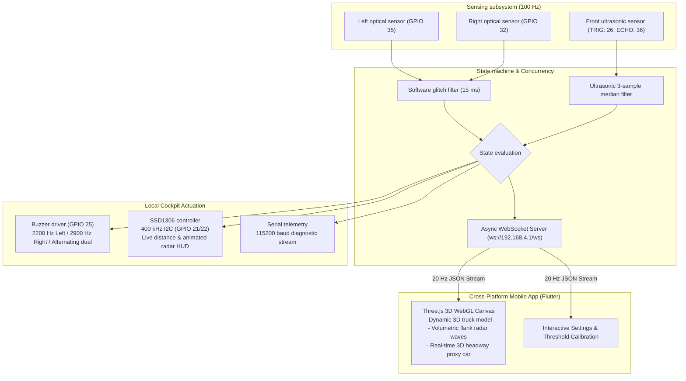

# BlindSpottr: Blind-Spot Monitoring System

<div align="center">

[](https://platformio.org/)
[](https://www.espressif.com/en/products/socs/esp32)
[](https://github.com/espressif/arduino-esp32)
[](https://flutter.dev/)
[](https://www.adafruit.com/)
[]()
[]()
[](LICENSE)

<p align="center">
  A blind-spot monitoring, front headway tracking, and Tesla-style 3D mobile telemetry platform for scale-model trucks using an ESP32, dual optical presence sensors, an HC-SR04 ultrasonic distance sensor, an SSD1306 OLED HUD, and a cross-platform Flutter app with embedded Three.js WebGL rendering.
</p>

</div>

---

## Table of contents

- [Overview](#overview)
- [Design choices](#design-choices)
- [System architecture](#system-architecture)
- [Display interface and 3D Mobile HUD](#display-interface-and-3d-mobile-hud)
- [Audio alert patterns](#audio-alert-patterns)
- [Hardware pinout and wiring](#hardware-pinout-and-wiring)
- [State machine](#state-machine)
- [Mobile application](#mobile-application)
- [Building and flashing](#building-and-flashing)
- [Project structure](#project-structure)
- [License](#license)

---

## Overview

Side mirrors leave blind spots where overtaking vehicles disappear from a driver's peripheral view. In scale models and robotics, simple obstacle detection scripts often rely on `delay()`, which halts execution, starves sensor reads, and causes display stutter.

BlindSpottr uses a non-blocking loop running on an ESP32. It samples two infrared distance sensors and a front ultrasonic sensor, updates an SSD1306 OLED display with animated top-down telemetry and live centimeter readings, and streams live JSON telemetry at 20 Hz over an asynchronous WebSocket server to a Flutter mobile app featuring an interactive Tesla-style 3D WebGL HUD.

```text
               Ahead / Front Ultrasonic (HC-SR04)
                            ▲
                            │
                 ┌──────────────────────┐
                 │     TOY TRUCK CAB    │
       [Left IR] │                      │ [Right IR]
       (GPIO 35) │                      │ (GPIO 32)
          ◄──────┤                      ├──────►
       Left Zone │                      │ Right Zone
                 │      CARGO BED       │
                 └──────────────────────┘
                            │
                            ▼
              OLED HUD, Buzzer & 3D Mobile App
```

---

## Design choices

- Non-blocking loop: The firmware uses timestamp arithmetic with `millis()` rather than `delay()`. Sensor polling, display refreshes, and buzzer cadences run independently.
- Tone separation: Left and right warnings use distinct sound frequencies (2200 Hz vs 2900 Hz). The buzzer alerts only on blind spot presence and remains silent for front headway distance.
- Tesla-style 3D perception: The mobile app renders an interactive 3D scene using Three.js inside a Flutter container. A dynamic 3D obstacle proxy slides forward and backward matching the measured centimeter headway in real time, while volumetric radar waves emit from the side mirrors when obstacles are detected.
- Asynchronous WebSockets: The ESP32 hosts its own Wi-Fi Access Point (`BlindSpottr-AP`) and streams live telemetry over WebSockets at 20 Hz without blocking sensor loops.

---

## System architecture



---

## Display interface and 3D Mobile HUD

### 1. Local 128x64 OLED HUD
The dashboard centers on a top-down view of the truck chassis, showing animated road markers, radar wave pulses, and live distance ahead of the cab:

```text
+-------------------------------------------------------+
| <<<           B L I N D S P O T T R               >>> |
|-------------------------------------------------------|
|  [!]L       .-----.  [ 28cm ]  .-----.          [!]R  |
|  ((((       |     |  |      |  |     |          ))))  |
|             '-----'  |______|  '-----'                |
|                        ||                             |
|                      [====]                           |
|-------------------------------------------------------|
|               << LEFT HAZARD DETECTED <<              |
+-------------------------------------------------------+
```

### 2. Tesla-Style 3D Mobile App
- Live 3D truck rendered with PBR materials, headlights, and cargo bed.
- Infinite scrolling road grid conveying forward speed.
- Dynamic 3D obstacle proxy vehicle that slides closer or farther matching the front distance in centimeters.
- Volumetric glowing red radar rings that pulse on the vehicle mirrors when an obstacle enters the blind spot.

---

## Hardware pinout and wiring

| Subsystem | Signal | ESP32 GPIO | Pin type | Wiring note |
| :--- | :--- | :---: | :---: | :--- |
| Left IR sensor | `PIN_IR_LEFT` | GPIO 35 | Input | Input-only (GPI). Active-low optical comparator |
| Right IR sensor | `PIN_IR_RIGHT` | GPIO 32 | Input | Digital input with pull-up. Active-low optical comparator |
| Ultrasonic trigger | `PIN_US_TRIG` | GPIO 26 | Output | 10 microsecond trigger pulse |
| Ultrasonic echo | `PIN_US_ECHO` | GPIO 36 (VP) | Input | Ultrasonic echo pulse input |
| Ultrasonic VCC | VCC | VIN | Power | 5V DC supply from USB bus |
| Buzzer | `PIN_BUZZER` | GPIO 25 | Output | Driven by LEDC PWM, 8-bit duty resolution |
| OLED SDA | `PIN_OLED_SDA` | GPIO 21 | I2C Data | 3.3V logic, standard hardware Wire |
| OLED SCL | `PIN_OLED_SCL` | GPIO 22 | I2C Clock | 3.3V logic, 400 kHz fast mode |

---

## Mobile application

The cross-platform Flutter application lives in the `mobile/` directory:
- `lib/models/telemetry.dart`: Strongly-typed telemetry data model and settings state.
- `lib/services/telemetry_service.dart`: Asynchronous WebSocket client with 3-second auto-reconnect logic and latency tracking.
- `lib/views/hud/hud_screen.dart`: Houses the embedded Three.js WebGL canvas and telemetry cards.
- `lib/views/settings/settings_screen.dart`: Configurable safety thresholds (10 cm to 100 cm slider), acoustic toggles, and IP setup.
- `web/threejs/index.html`: Three.js WebGL 3D rendering pipeline with procedural road lines, camera damping, and volumetric radar wave rings.

---

## Building and flashing

### 1. Flash the ESP32 Firmware
```bash
pio run --target upload
```

### 2. Launch the Mobile Application
1. Connect your smartphone, tablet, or laptop to the vehicle's Wi-Fi network:
   - **SSID**: `BlindSpottr-AP`
   - **Password**: `blindspottr123`
2. Open the mobile project:
   - You can open `mobile/web/threejs/index.html` in any mobile browser, or run the Flutter application:
   ```bash
   cd mobile
   flutter run
   ```

---

## Project structure

```text
BlindSpottr/
├── platformio.ini         # PlatformIO build flags and library dependencies
├── include/
│   └── config.h           # Central pinout, timing, and Wi-Fi configuration
├── src/
│   ├── main.cpp           # Main execution loop and subsystem orchestration
│   ├── sensors.h / .cpp   # Non-blocking optical and ultrasonic acquisition
│   ├── display.h / .cpp   # SSD1306 OLED HUD graphics and animation
│   ├── buzzer.h / .cpp    # Multi-frequency buzzer driver using LEDC PWM
│   └── telemetry_server.h / .cpp # Async WebSocket server (ws://192.168.4.1/ws)
├── mobile/                # Cross-platform Flutter + Three.js mobile app
│   ├── lib/               # Dart models, services, HUD, and settings views
│   └── web/threejs/       # WebGL 3D Tesla-style visualization pipeline
└── docs/                  # Architecture, specifications, and prompt library
```

---

## License

This project is licensed under the MIT License. See `LICENSE` for details.
