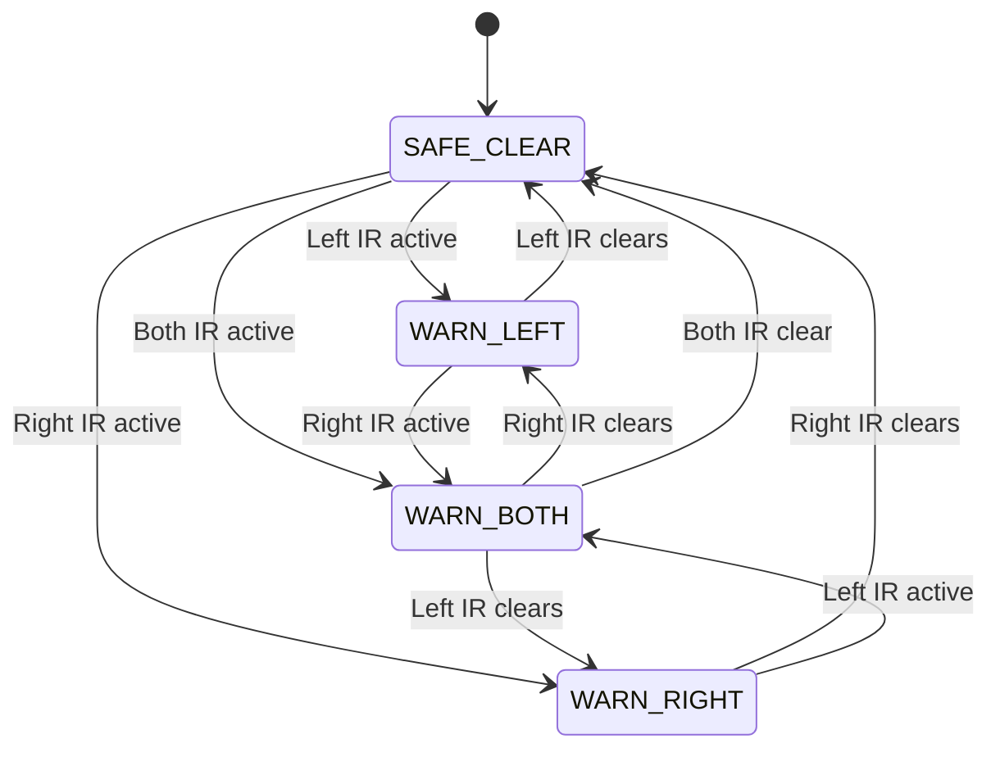

# BlindSpottr: Autonomous Blind-Spot Monitoring & Headway Perception Platform

<div align="center">

[](https://platformio.org/)
[](https://www.espressif.com/en/products/socs/esp32)
[](https://github.com/espressif/arduino-esp32)
[](http://192.168.4.1)
[](https://www.adafruit.com/)
[]()
[]()
[](LICENSE)

<p align="center">
  A real-time blind-spot monitoring, front headway tracking, and Tesla-style 3D perception platform for scale-model trucks using an ESP32, dual optical presence sensors, an HC-SR04 ultrasonic distance sensor, an SSD1306 OLED HUD, and an embedded browser-accessible WebGL perception canvas.
</p>

</div>

---

## Table of contents

- [Overview](#overview)
- [Key architectural highlights](#key-architectural-highlights)
- [Hardware pinout and wiring](#hardware-pinout-and-wiring)
- [State machine and threat arbitration](#state-machine-and-threat-arbitration)
- [Cockpit OLED HUD](#cockpit-oled-hud)
- [Tesla-style mobile WebGL perception HUD](#tesla-style-mobile-webgl-perception-hud)
- [Audio alert matrix](#audio-alert-matrix)
- [Building and flashing](#building-and-flashing)
- [Connecting your phone or laptop](#connecting-your-phone-or-laptop)
- [Project structure](#project-structure)
- [License](#license)

---

## Overview

Side mirrors leave blind spots where overtaking vehicles disappear from a driver's peripheral view. In scale models and robotics, simple obstacle detection scripts often rely on `delay()`, which halts execution, starves sensor reads, and causes display stutter.

BlindSpottr uses a 100 Hz non-blocking loop running on an ESP32. It samples two infrared distance sensors and a front ultrasonic sensor, updates an SSD1306 OLED display with animated top-down telemetry, and streams live telemetry at 20 Hz over an asynchronous WebSocket server to an interactive Tesla-style perception dashboard accessible on any mobile browser.

```text
               Ahead / Front Ultrasonic (HC-SR04)
                            ▲
                            │
                 ┌──────────────────────┐
                 │     TOY TRUCK CAB    │
       [Left IR] │                      │ [Right IR]
       (GPIO 35) │                      │ (GPIO 32)
          ◄──────┤                      ├──────►
       Left Zone │                      │ Right Zone
                 │      CARGO BED       │
                 └──────────────────────┘
                            │
                            ▼
              OLED HUD, Buzzer & 3D Web HUD
```

---

## Key architectural highlights

- Non-blocking loop: The firmware uses timestamp arithmetic with `millis()` rather than `delay()`. Sensor polling, display refreshes, and buzzer cadences run independently.
- Acoustic pitch separation: Left and right warnings use distinct sound frequencies (2200 Hz vs 2900 Hz). The buzzer alerts only on blind spot presence and remains silent for front headway distance.
- Tesla-style perception dashboard: Served directly from ESP32 flash memory (`http://192.168.4.1/`), rendering an animated 3D truck, perspective road lines, dynamic front obstacle proxy, and volumetric blind-spot radar arcs with zero external internet dependencies.
- In-browser settings modal: Easily configure personal phone hotspot credentials via a web form saved to ESP32 non-volatile storage (NVS) without modifying or re-flashing code.
- Acoustic ringdown rejection: Ultrasonic measurements discard false transducer reflections below 400 microseconds (< 7 cm) and apply a 3-sample median filter to eliminate erratic readings.

---

## Hardware pinout and wiring

```text
 ┌─────────────────────────┐                                 ┌─────────────────────────┐
 │   LEFT IR SENSOR        │                                 │   RIGHT IR SENSOR       │
 │   (TCRT5000 / LM393)    │                                 │   (TCRT5000 / LM393)    │
 │  ┌───────────────────┐  │                                 │  ┌───────────────────┐  │
 │  │ [VCC] [GND] [DO]  │  │                                 │  │ [VCC] [GND] [DO]  │  │
 └──┴───┬─────┬────┬────┴──┘                                 └──┴───┬─────┬────┬────┴──┘
        │     │    │                                                │     │    │
        │     │    └──────────────────────────────────────┐         │     │    │
        │     │                                           │         │     │    │
        │     │    ┌──────────────────────────────────────┴─────────┼─────┼────┘
        │     │    │            ESP32 DEVKIT V1                     │     │
        │     │    │               (38-PIN)                         │     │
        │     │    │                                                │     │
        │     │    │  [VIN] ──────── 5V DC Supply Rail ─────────────┼─────┤
        │     │    │  [3V3] ──────── 3.3V DC Logic Rail ────────────┼─────┤
        │     │    │  [GND] ──────── Common Ground Rail ────────────┼─────┤
        │     │    │                                                │     │
        │     └────┤► [GND]                            [GPIO 22] ◄──┼─────┼───────┐ (SCL)
        └──────────┤► [3V3]                            [GPIO 21] ◄──┼─────┼───┐   │ (SDA)
                   │  [GPIO 35] ◄── (Left DO)          [GPIO 25] ───┼─────┼─┐ │   │   │ (Tone)
                   │  [GPIO 32] ◄── (Right DO)         [GPIO 26] ───┼─────┼─┼─┼───┼───┼─────┐ (TRIG)
                   │  [GPIO 36] ◄── (ECHO Pulse)       [GND]        │     │ │ │   │   │     │
                   └──────────────────▲─────────────────────────────┘     │ │ │   │   │     │
                                      │                                   │ │ │   │   │     │
             ┌────────────────────────┘                                   │ │ │   │   │     │
             │                                                            │ │ │   │   │     │
             ▼                                                            ▼ ▼ ▼   ▼   ▼     ▼
 ┌─────────────────────────┐                              ┌─────────────────────────┐ ┌─────────────────────────┐
 │   BUZZER MODULE         │                              │   SSD1306 OLED (128x64) │ │   HC-SR04 ULTRASONIC    │
 │   (Active or Passive)   │                              │   (I2C Display)         │ │   (Front Headway)       │
 │  ┌───────────────────┐  │                              │  ┌───────────────────┐  │ │  ┌───────────────────┐  │
 │  │ [GND] [VCC] [SIG] │  │                              │  │[GND] [VCC] [SCL] [SDA│ │  │[VCC] [TRIG][ECHO][GND]│
 └──┴───┬─────┬─────▲───┴──┘                              └──┴──┬─────┬─────▲─────▲─┘ └──┴──┬─────▲─────┬────┬───┘
        │     │     │ (GPIO 25 PWM)                             │     │     │     │         │     │     │    │
        │     └─────┼──────────────── 3.3V Rail ────────────────┼─────┘     │     │         │     │     │    │
        └───────────┼──────────────── Ground Rail ──────────────┴───────────┼─────┼─────────┼─────┼─────┼────┘
                    │                                                       │     │         │     │     │
                    │                                                       │     │    (5V) ┘     │     │
                    │                      (ESP32 GPIO 21 SDA) ─────────────┼─────┘               │     │
                    │                      (ESP32 GPIO 22 SCL) ─────────────┘                     │     │
                    │                                                                             │     │
                    └─────────────────────────────────────────────────────────────────────────────┼─────┘
                                           (ESP32 GPIO 26 Trigger Pulse) ─────────────────────────┘
```

| Subsystem | Signal | ESP32 GPIO | Pin type | Wiring note |
| :--- | :--- | :---: | :---: | :--- |
| Left IR sensor | `PIN_IR_LEFT` | GPIO 35 | Input | Input-only (GPI). Active-low optical comparator |
| Right IR sensor | `PIN_IR_RIGHT` | GPIO 32 | Input | Digital input with pull-up. Active-low optical comparator |
| Ultrasonic trigger | `PIN_US_TRIG` | GPIO 26 | Output | 10 microsecond trigger pulse |
| Ultrasonic echo | `PIN_US_ECHO` | GPIO 36 (VP) | Input | Ultrasonic echo pulse input |
| Ultrasonic VCC | VCC | VIN | Power | 5V DC supply from USB bus |
| Buzzer | `PIN_BUZZER` | GPIO 25 | Output | Driven by LEDC PWM, 8-bit duty resolution |
| OLED SDA | `PIN_OLED_SDA` | GPIO 21 | I2C Data | 3.3V logic, standard hardware Wire |
| OLED SCL | `PIN_OLED_SCL` | GPIO 22 | I2C Clock | 3.3V logic, 400 kHz fast mode |

---

## State machine and threat arbitration



---

## Cockpit OLED HUD

The 128x64 OLED layout centers on a top-down view of the truck chassis, showing animated road markers, radar wave pulses, and live distance ahead of the cab:

```text
+-------------------------------------------------------+
| <<<           B L I N D S P O T T R               >>> |
|-------------------------------------------------------|
|  [!]L       .-----.  [ 28cm ]  .-----.          [!]R  |
|  ((((       |     |  |      |  |     |          ))))  |
|             '-----'  |______|  '-----'                |
|                        ||                             |
|                      [====]                           |
|-------------------------------------------------------|
|               << LEFT HAZARD DETECTED <<              |
+-------------------------------------------------------+
```

---

## Tesla-style mobile WebGL perception HUD

When opening the dashboard in a browser, a high-performance 3D perception canvas provides full situational awareness:
- **Central Vehicle**: 3D commercial truck with headlights, cargo bed, and suspension oscillation.
- **Dynamic 3D Obstacle Proxy**: Visualized vehicle model that moves closer or farther matching measured headway in centimeters.
- **Volumetric Radar Rings**: Red pulsing arcs ignite on the left and right mirrors when blind spots are obstructed.
- **Speed & Gear Cluster**: Simulated digital drive gear pills (D/N/R/P) and dynamic velocity indicator.
- **Interactive Settings Modal**: Adjust warning distance thresholds and configure phone hotspot credentials on the fly.

---

## Audio alert patterns

The buzzer connects to GPIO 25 and runs through ESP32 hardware PWM (LEDC channel 0). It alerts solely on blind-spot obstacles:

| State | Frequency | Cadence | Tone description |
| :--- | :--- | :--- | :--- |
| Clear | Silent | Off | No output |
| Left obstacle | 2200 Hz | 100 ms on, 120 ms off | Steady mid-pitch pulse |
| Right obstacle | 2900 Hz | 100 ms on, 120 ms off | High-pitch pulse |
| Both sides blocked | 3400 Hz and 2400 Hz | 50 ms per step | Rapid alternating chirp |

---

## Building and flashing

### 1. Build and Upload
```bash
pio run --target upload
```

### 2. Monitor Serial Output
```bash
pio device monitor --baud 115200
```
The terminal displays the Wi-Fi network credentials and IP address without spamming telemetry lines.

---

## Connecting your phone or laptop

1. Connect your device to the truck's access point:
   - **SSID**: `BlindSpottr-AP`
   - **Password**: `blindspottr123`
2. Open Safari or Chrome and navigate to:
   👉 **`http://192.168.4.1`** (or `http://blindspottr.local` on supported networks)
3. To connect the truck to your personal phone hotspot instead:
   - Tap **⚙️ Settings** on the web HUD.
   - Enter your hotspot SSID and password, then tap **Save & Connect Truck**.

---

## Project structure

```text
BlindSpottr/
├── platformio.ini         # PlatformIO build configuration and libraries
├── include/
│   └── config.h           # Central pinout, timing, and network configuration
├── src/
│   ├── main.cpp           # Main loop and state machine resolution
│   ├── sensors.h / .cpp   # Non-blocking IR and ultrasonic sensor acquisition
│   ├── display.h / .cpp   # SSD1306 OLED HUD graphics and animation
│   ├── buzzer.h / .cpp    # Multi-frequency buzzer driver using LEDC PWM
│   ├── telemetry_server.h / .cpp # Async WebSocket server (ws://192.168.4.1/ws)
│   └── dashboard_html.h   # In-memory Tesla-style WebGL perception HUD
├── mobile/                # Cross-platform Flutter mobile workspace
└── docs/                  # Architecture, specifications, and prompt library
```

---

## License

This project is licensed under the MIT License. See `LICENSE` for details.
