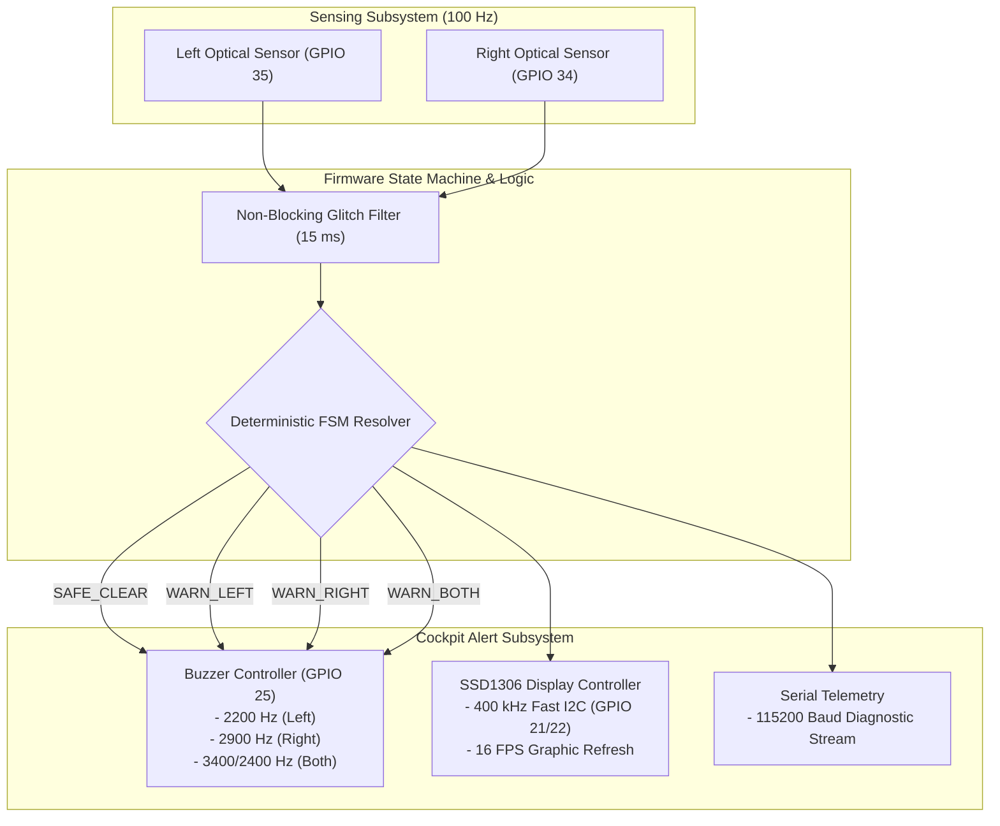
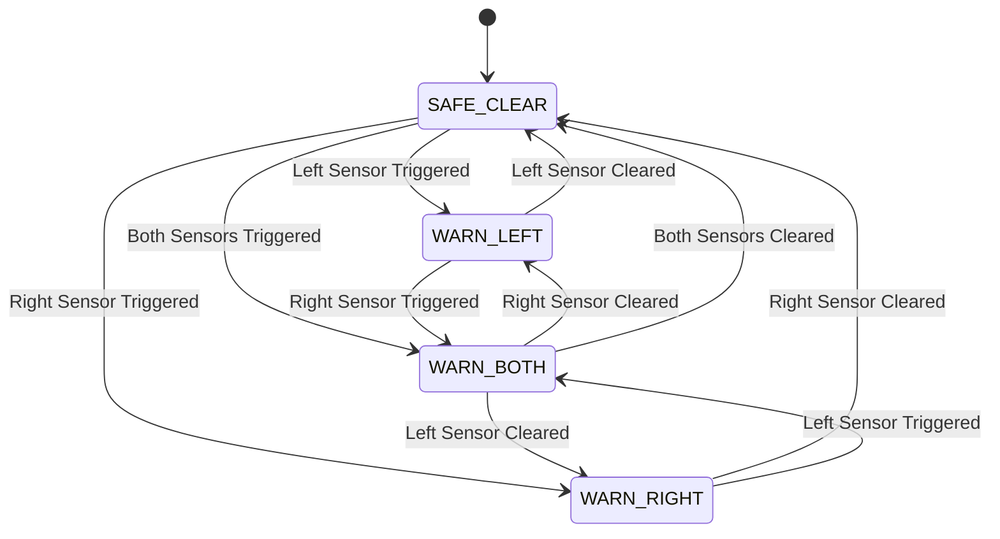

# BlindSpottr 🚛 — Intelligent Blind-Spot Monitoring System

<div align="center">


<br/>

[](https://platformio.org/)
[](https://www.espressif.com/en/products/socs/esp32)
[](https://github.com/espressif/arduino-esp32)
[](https://www.adafruit.com/)
[]()
[]()
[](LICENSE)

<p align="center">
  <b>A real-time, non-blocking Blind-Spot Monitoring (BSM) prototype built for scale-model trucks and automotive robotics, featuring dynamic graphical OLED telemetry, dual-zone optical presence sensing, and multi-frequency acoustic threat arbitration.</b>
</p>

</div>

---

## 📖 Table of Contents

- [Overview & Problem Statement](#-overview--problem-statement)
- [Key Features](#-key-features)
- [System Architecture](#-system-architecture)
- [OLED Graphical Dashboard](#-oled-graphical-dashboard)
- [Multi-Tone Acoustic Alert Engine](#-multi-tone-acoustic-alert-engine)
- [Hardware Pinout & Circuit Interfacing](#-hardware-pinout--circuit-interfacing)
- [Finite State Machine (FSM)](#-finite-state-machine-fsm)
- [Getting Started](#-getting-started)
- [Project Structure](#-project-structure)
- [Future Enhancements](#-future-enhancements)
- [License](#-license)

---

## 🔍 Overview & Problem Statement

Blind spots are responsible for a significant fraction of commercial vehicle collisions during lane changes and tight turning maneuvers. Standard hobby obstacle detection projects rely on blocking delays (`delay()`) or simple single-sensor thresholds that freeze display updates and trigger annoying, mono-pitch buzzing.

**BlindSpottr** implements an automotive-grade, non-blocking firmware architecture that:
- Continuously polls dual-side optical sensors at **100 Hz** without blocking or jitter.
- Uses **hardware LEDC PWM** to synthesize distinct musical pitches for Left, Right, and Dual-hazard warnings.
- Renders an **interactive 16 FPS pixel-art dashboard** with top-down vehicle silhouettes and dynamic radar waves on an SSD1306 OLED display.
- Gracefully tolerates I2C disconnections without stalling sensor loops or audio alerts.

```text
    [ LEFT BLIND SPOT ]                     [ RIGHT BLIND SPOT ]
     TCRT5000 / LM393                        TCRT5000 / LM393
     Optical Sensor                          Optical Sensor
           │                                       │
     (GPIO 35 input)                         (GPIO 34 input)
           └──────────────────┐ ┌──────────────────┘
                              ▼ ▼
                  ┌─────────────────────────┐
                  │   ESP32 DUAL-CORE MCU   │
                  │  100 Hz Non-Blocking    │
                  │   Deterministic FSM     │
                  └───────────┬─────────────┘
                              │
             ┌────────────────┴────────────────┐
             ▼                                 ▼
   [ OLED DASHBOARD ]                  [ ACTIVE/PASSIVE BUZZER ]
  128x64 SSD1306 (I2C)                 GPIO 25 (Hardware PWM)
  - Top-down truck view                - Left:  2200 Hz Pulsed
  - Animated radar waves               - Right: 2900 Hz Pulsed
  - Dynamic chevron alerts             - Dual:  3400/2400 Hz Warble
```

---

## ⚡ Key Features

- **Zero-Delay Architecture**: Completely free of `delay()` calls during runtime loops. Uses wrap-safe `millis()` delta timers for predictable scheduling.
- **Dynamic Graphical HUD**: Custom 128×64 OLED display driver featuring a top-down truck wireframe, side mirrors, wheels, and animated outward-pulsing radar waves.
- **Multi-Frequency Acoustic Feedback**:
  - **Left Obstacle**: 2200 Hz mid-range pulsed tone (100 ms ON / 120 ms OFF).
  - **Right Obstacle**: 2900 Hz high-frequency warning tone (100 ms ON / 120 ms OFF).
  - **Dual Hazard**: Rapid alternating warble alarm switching between 3400 Hz and 2400 Hz every 50 ms.
  - **Clear Road**: Immediate, clean acoustic silence.
- **Fail-Safe I2C Engine**: Bus timeout protection (`Wire.setTimeOut(50)`) and auto-scanning across addresses `0x3C` and `0x3D`. If the screen is disconnected, sensing and sound continue flawlessly.
- **Hardware Agnostic Buzzer Driver**: Supports both active piezo buzzers and passive electromagnetic transducers via ESP32 LEDC PWM.

---

## 🏗 System Architecture



---

## 🖥 OLED Graphical Dashboard

The SSD1306 128×64 monochrome OLED renders an automotive HUD tailored for rapid driver recognition:

```text
+-------------------------------------------------------+
| <<<           B L I N D S P O T T R               >>> |
|-------------------------------------------------------|
|  [!]L       .-----.  [====]  .-----.            [!]R  |
|  ((((       |     |  |    |  |     |            ))))  |
|             '-----'  |____|  '-----'                  |
|                        ||                             |
|                      [====]                           |
|-------------------------------------------------------|
|               << LEFT HAZARD DETECTED <<              |
+-------------------------------------------------------+
```

### Visual Modes:
1. **ROAD CLEAR**: Symmetrical dotted road lines flank the truck with `>>> ROAD CLEAR <<<` banner.
2. **LEFT HAZARD**: Inverted `[!] L` badge on left edge, animated left radar waves pulsing outward from the mirror, and bottom inverted alert banner.
3. **RIGHT HAZARD**: Inverted `[!] R` badge on right edge, animated right radar waves pulsing outward, and right chevron indicators.
4. **DUAL HAZARD**: Both side waves pulse concurrently with high-visibility flashing `!! DUAL SIDE WARN !!` banner.

---

## 🎵 Multi-Tone Acoustic Alert Engine

Different hazard directions demand different acoustic signatures so drivers can react without looking down:

| Threat State | Frequency | Cadence | Acoustic Feel |
| :--- | :--- | :--- | :--- |
| **Clear Road** | `0 Hz` | Silent | Quiet cockpit |
| **Left Blind Spot** | `2200 Hz` | 100 ms ON / 120 ms OFF | Rhythmic mid-range pulse |
| **Right Blind Spot** | `2900 Hz` | 100 ms ON / 120 ms OFF | Piercing high-pitch alert |
| **Both Sides Blocked** | `3400 Hz ⇄ 2400 Hz` | 50 ms / 50 ms toggle | Rapid two-tone warble alarm |

---

## 📌 Hardware Pinout & Circuit Interfacing

| Subsystem | Signal Name | ESP32 GPIO | Direction | Electrical Notes |
| :--- | :--- | :---: | :---: | :--- |
| **Left IR Sensor** | `PIN_IR_LEFT` | **GPIO 35** | Input | Input-only pin (GPI). Active-LOW optical comparator |
| **Right IR Sensor** | `PIN_IR_RIGHT` | **GPIO 34** | Input | Input-only pin (GPI). Active-LOW optical comparator |
| **Cockpit Buzzer** | `PIN_BUZZER` | **GPIO 25** | Output | Driven by ESP32 LEDC PWM (Channel 0, 8-bit) |
| **OLED SDA** | `PIN_OLED_SDA` | **GPIO 21** | I2C Data | 3.3V logic, default hardware Wire |
| **OLED SCL** | `PIN_OLED_SCL` | **GPIO 22** | I2C Clock | 3.3V logic, 400 kHz Fast Mode |
| **US TRIG (Optional)**| `PIN_US_TRIG` | **GPIO 26** | Output | 10µs ultrasonic trigger pulse |
| **US ECHO (Optional)**| `PIN_US_ECHO` | **GPIO 36** | Input | Bounded timeout (~3m). Requires voltage divider! |

> ⚠️ **Electrical Notice**: GPIO 34 and GPIO 35 are input-only pins on the ESP32 silicon and do not possess internal software pull-up resistors. Ensure your IR sensor breakout modules have onboard pull-ups (standard on LM393 modules).

---

## 🔄 Finite State Machine (FSM)



---

## 🚀 Getting Started

### Prerequisites
- [Visual Studio Code](https://code.visualstudio.com/) with the **PlatformIO IDE** extension.
- ESP32 Development Board (NodeMCU / DevKit V1 38-Pin).
- 2× Digital IR Obstacle Modules (LM393 / TCRT5000).
- 1× 0.96" SSD1306 128×64 I2C OLED Display.
- 1× Active or Passive Buzzer module.

### Build and Flash
1. Clone the repository:
   ```bash
   git clone https://github.com/devinfinix/BlindSpottr.git
   cd BlindSpottr
   ```

2. Compile the project with PlatformIO:
   ```bash
   pio run
   ```

3. Flash to ESP32:
   ```bash
   pio run --target upload
   ```

4. Launch the Serial Monitor (115200 Baud):
   ```bash
   pio device monitor --baud 115200
   ```

---

## 📁 Project Structure

```text
BlindSpottr/
├── platformio.ini              # PlatformIO environments & library dependencies
├── include/
│   └── config.h                # Authoritative hardware pinouts, cadences & timings
├── src/
│   ├── main.cpp                # Main non-blocking orchestration & UART telemetry
│   ├── sensors.h / .cpp        # Independent debounced IR sensor acquisition
│   ├── display.h / .cpp        # Graphic OLED top-down HUD & animation engine
│   └── buzzer.h / .cpp         # Multi-tone LEDC PWM acoustic driver
└── docs/                       # Project specifications & architecture docs
```

---

## 💡 Future Enhancements

- [ ] **Microwave Radar Fusion**: Integrate dual RCWL-0516 Doppler radar modules to detect high-speed approaching vehicles up to 7 meters away.
- [ ] **Front Collision Warning**: Re-enable front HC-SR04 ultrasonic sensor with dynamic distance bar in OLED HUD.
- [ ] **Web Dashboard**: ESP32 Wi-Fi SoftAP broadcasting real-time WebSocket vehicle telemetry to a driver's mobile browser.
- [ ] **Turn-Signal Blind-Spot Camera**: Integrate ESP32-CAM to stream live side-mirror video when turn signals are engaged.

---

## 📜 License

Distributed under the **MIT License**. See `LICENSE` for more information.
