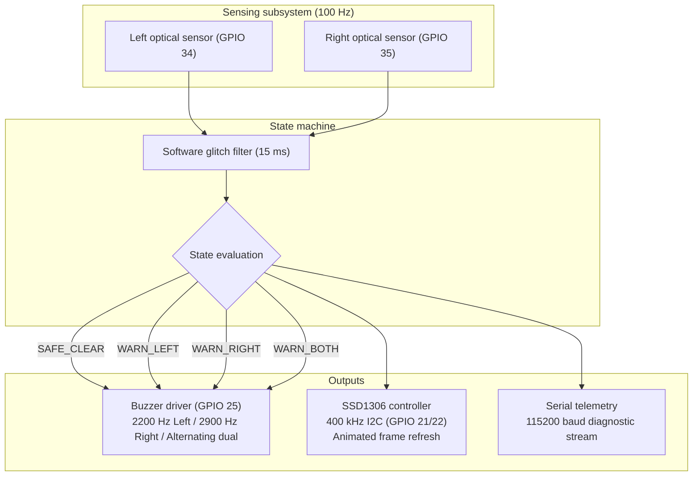
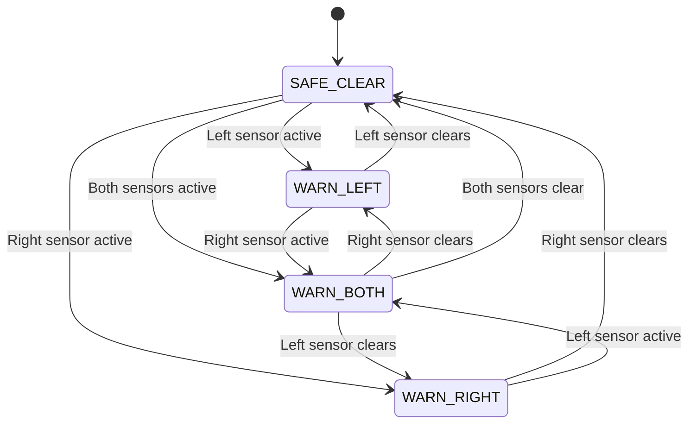

# BlindSpottr: Blind-Spot Monitoring System

<div align="center">

[](https://platformio.org/)
[](https://www.espressif.com/en/products/socs/esp32)
[](https://github.com/espressif/arduino-esp32)
[](https://www.adafruit.com/)
[]()
[]()
[](LICENSE)

<p align="center">
  A blind-spot monitoring prototype for scale-model trucks using an ESP32, dual optical presence sensors, an SSD1306 OLED display, and multi-frequency buzzer alerts.
</p>

</div>

---

## Table of contents

- [Overview](#overview)
- [Design choices](#design-choices)
- [System architecture](#system-architecture)
- [Display interface](#display-interface)
- [Audio alert patterns](#audio-alert-patterns)
- [Hardware pinout and wiring](#hardware-pinout-and-wiring)
- [State machine](#state-machine)
- [Building and flashing](#building-and-flashing)
- [Project structure](#project-structure)
- [Planned additions](#planned-additions)
- [License](#license)

---

## Overview

Side mirrors leave blind spots where overtaking vehicles disappear from a driver's peripheral view. In scale models and robotics, simple obstacle detection scripts often rely on `delay()`, which halts execution, starves sensor reads, and causes display stutter.

BlindSpottr uses a non-blocking loop running on an ESP32. It samples two infrared distance sensors at 100 Hz, updates an SSD1306 OLED display with animated top-down telemetry, and drives a buzzer using hardware PWM at different pitches depending on which side detects an obstacle.

```text
    [ Left blind spot ]                     [ Right blind spot ]
     TCRT5000 / LM393                        TCRT5000 / LM393
     Optical Sensor                          Optical Sensor
           │                                       │
     (GPIO 34 input)                         (GPIO 35 input)
           └──────────────────┐ ┌──────────────────┘
                              ▼ ▼
                  ┌─────────────────────────┐
                  │   ESP32 DevKit V1 MCU   │
                  │   100 Hz non-blocking   │
                  │    state arbitration    │
                  └───────────┬─────────────┘
                              │
             ┌────────────────┴────────────────┐
             ▼                                 ▼
       [ OLED HUD ]                    [ Hardware buzzer ]
   128x64 SSD1306 (I2C)              GPIO 25 (LEDC PWM timer)
   - Top-down truck graphic          - Left:  2200 Hz pulsed
   - Animated radar waves            - Right: 2900 Hz pulsed
   - Forward road guides             - Dual:  3400/2400 Hz chirp
```

---

## Design choices

- Non-blocking loop: The firmware uses timestamp arithmetic with `millis()` rather than `delay()`. Sensor polling, display refreshes, and buzzer cadences run independently.
- Tone separation: Left and right warnings use different sound frequencies. A driver can tell which side has an obstacle by pitch alone.
- Isolated I2C handling: The display controller sets a 50 ms bus timeout and scans for device addresses at startup. If the screen disconnects or glitches, sensor polling and audio alerts keep running.
- Noise filtering: Raw sensor reads pass through a 15 ms debouncer before triggering a state change, filtering out transient reflections.

---

## System architecture



---

## Display interface

The 128x64 OLED layout centers on a top-down view of the truck chassis, showing animated road markers and radar wave pulses:

```text
+-------------------------------------------------------+
| <<<           B L I N D S P O T T R               >>> |
|-------------------------------------------------------|
|  [!]L       .-----.  [====]  .-----.            [!]R  |
|  ((((       |     |  |    |  |     |            ))))  |
|             '-----'  |____|  '-----'                  |
|                        ||                             |
|                      [====]                           |
|-------------------------------------------------------|
|               << LEFT HAZARD DETECTED <<              |
+-------------------------------------------------------+
```

Display states:
- Road clear: Dotted road lines flow past the truck cab, with a centered status label.
- Left obstacle: Radar pulses expand outward to the left, an inverted badge marks the left corner, and chevrons point left along the header.
- Right obstacle: Radar pulses expand outward to the right, with a matching badge on the right corner.
- Both obstacles: Radar waves pulse on both sides, and the bottom banner alternates colors for contrast.

---

## Audio alert patterns

The buzzer module connects to GPIO 25 and runs through ESP32 hardware PWM (LEDC channel 0). Tone frequencies and durations differ by obstacle location:

| State | Frequency | Cadence | Tone description |
| :--- | :--- | :--- | :--- |
| Clear | Silent | Off | No output |
| Left obstacle | 2200 Hz | 100 ms on, 120 ms off | Steady mid-pitch pulse |
| Right obstacle | 2900 Hz | 100 ms on, 120 ms off | High-pitch pulse |
| Both sides blocked | 3400 Hz and 2400 Hz | 50 ms per step | Rapid alternating chirp |

---

## Hardware pinout and wiring

```text
 ┌─────────────────────────┐                                 ┌─────────────────────────┐
 │   LEFT IR SENSOR        │                                 │   RIGHT IR SENSOR       │
 │   (TCRT5000 / LM393)    │                                 │   (TCRT5000 / LM393)    │
 │  ┌───────────────────┐  │                                 │  ┌───────────────────┐  │
 │  │ [VCC] [GND] [DO]  │  │                                 │  │ [VCC] [GND] [DO]  │  │
 └──┴───┬─────┬────┬────┴──┘                                 └──┴───┬─────┬────┬────┴──┘
        │     │    │                                                │     │    │
        │     │    └───────────────────────┐   ┌────────────────────┼─────┼────┘
        │     │                            │   │                    │     │
        │     │    ┌───────────────────────┴───┴────────────────┐   │     │
        │     │    │            ESP32 DEVKIT V1                 │   │     │
        │     │    │               (38-PIN)                     │   │     │
        │     │    │                                            │   │     │
        │     │    │  [3V3] ──────── Power (3.3V) Rail ─────────┼───┤     │
        │     │    │  [GND] ──────── Common Ground Rail ────────┼───┼─────┤
        │     │    │                                            │   │     │
        │     └────┤► [GND]                        [GPIO 22] ◄──┼───┼─────┼───────┐ (SCL)
        └──────────┤► [3V3]                        [GPIO 21] ◄──┼───┼─────┼───┐   │ (SDA)
                   │  [GPIO 34] ◄── (Left DO)      [GPIO 25] ───┼───┼─┐   │   │   │ (Tone)
                   │  [GPIO 35] ◄── (Right DO)     [GND]        │   │ │   │   │   │
                   │                                            │   │ │   │   │   │
                   └────────────────────────────────────────────┘   │ │   │   │   │
                                                                    │ │   │   │   │
             ┌──────────────────────────────────────────────────────┘ │   │   │   │
             │                                                        │   │   │   │
             ▼                                                        ▼   ▼   ▼   ▼
 ┌─────────────────────────┐                                ┌─────────────────────────┐
 │   BUZZER MODULE         │                                │   SSD1306 OLED (128x64) │
 │   (Active or Passive)   │                                │   (I2C Display)         │
 │  ┌───────────────────┐  │                                │  ┌───────────────────┐  │
 │  │ [GND] [VCC] [SIG] │  │                                │  │[GND] [VCC] [SCL] [SDA]
 └──┴───┬─────┬─────▲───┴──┘                                └──┴──┬─────┬─────▲─────▲─┘
        │     │     │ (GPIO 25 PWM)                               │     │     │     │
        │     └─────┼──────────────── 3.3V Rail ──────────────────┼─────┘     │     │
        └───────────┼──────────────── Ground Rail ────────────────┘           │     │
                    │                                                         │     │
                    └─────────────────────────────────────────────────────────┼─────┘
                                                                              │
                                       (ESP32 GPIO 22 Clock) ─────────────────┘
```

| Subsystem | Signal | ESP32 GPIO | Pin type | Wiring note |
| :--- | :--- | :---: | :---: | :--- |
| Left IR sensor | `PIN_IR_LEFT` | GPIO 34 | Input | Input-only pin (GPI). Active-low digital signal |
| Right IR sensor | `PIN_IR_RIGHT` | GPIO 35 | Input | Input-only pin (GPI). Active-low digital signal |
| Buzzer | `PIN_BUZZER` | GPIO 25 | Output | Driven by LEDC PWM, 8-bit duty resolution |
| OLED SDA | `PIN_OLED_SDA` | GPIO 21 | I2C Data | 3.3V logic, standard hardware Wire |
| OLED SCL | `PIN_OLED_SCL` | GPIO 22 | I2C Clock | 3.3V logic, 400 kHz fast mode |
| Ultrasonic trigger (optional) | `PIN_US_TRIG` | GPIO 26 | Output | 10 microsecond trigger pulse |
| Ultrasonic echo (optional) | `PIN_US_ECHO` | GPIO 36 | Input | Requires external resistor divider for 3.3V safety |

GPIO 34 and GPIO 35 are input-only pins on the ESP32 and lack internal pull-up resistors. Use sensor breakout boards with their own pull-up resistors on the comparator outputs.

---

## State machine



---

## Building and flashing

### Prerequisites
- Visual Studio Code with the PlatformIO IDE extension, or PlatformIO Core CLI.
- ESP32 development board (38-pin DevKit V1).
- Two digital infrared obstacle modules (TCRT5000 or LM393 comparator).
- One 0.96 inch SSD1306 I2C OLED display (128x64).
- One active or passive buzzer module.

### Commands

1. Clone the repository:
   ```bash
   git clone https://github.com/DevInfinix/BlindSpottr.git
   cd BlindSpottr
   ```

2. Compile the firmware:
   ```bash
   pio run
   ```

3. Upload to the connected ESP32:
   ```bash
   pio run --target upload
   ```

4. Open the serial monitor:
   ```bash
   pio device monitor --baud 115200
   ```

---

## Project structure

```text
BlindSpottr/
├── platformio.ini         # PlatformIO build flags and library dependencies
├── include/
│   └── config.h           # Pin allocations, frequencies, and loop timing constants
├── src/
│   ├── main.cpp           # Loop orchestration and serial telemetry output
│   ├── sensors.h / .cpp   # Debounced optical sensor reading
│   ├── display.h / .cpp   # OLED HUD rendering and animation
│   └── buzzer.h / .cpp    # Multi-frequency buzzer driver using LEDC PWM
└── docs/                  # Architecture and technical reference documents
```

---

## Planned additions

- Doppler radar: Adding RCWL-0516 microwave modules alongside the optical sensors to detect approaching objects before they enter the close-range blind zone.
- Front obstacle detection: Connecting an HC-SR04 sensor to the bumper to measure distance ahead of the truck.
- Turn signal escalation: Reading left and right turn signal inputs so the buzzer alerts only when the driver signals into an occupied lane.

---

## License

This project is licensed under the MIT License. See `LICENSE` for details.
