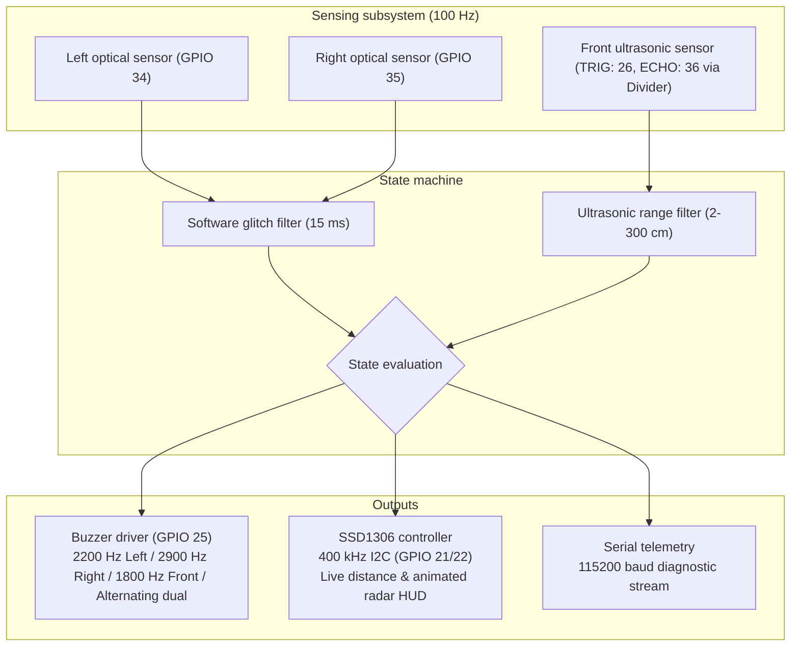
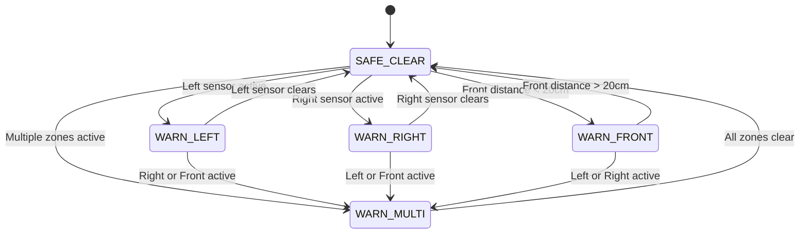

# BlindSpottr: Blind-Spot Monitoring System

<div align="center">

[](https://platformio.org/)
[](https://www.espressif.com/en/products/socs/esp32)
[](https://github.com/espressif/arduino-esp32)
[](https://www.adafruit.com/)
[]()
[]()
[](LICENSE)

<p align="center">
  A blind-spot monitoring and headway warning prototype for scale-model trucks using an ESP32, dual optical presence sensors, an HC-SR04 front distance sensor, an SSD1306 OLED display, and multi-frequency buzzer alerts.
</p>

</div>

---

## Table of contents

- [Overview](#overview)
- [Design choices](#design-choices)
- [System architecture](#system-architecture)
- [Display interface](#display-interface)
- [Audio alert patterns](#audio-alert-patterns)
- [Hardware pinout and wiring](#hardware-pinout-and-wiring)
- [State machine](#state-machine)
- [Building and flashing](#building-and-flashing)
- [Project structure](#project-structure)
- [Planned additions](#planned-additions)
- [License](#license)

---

## Overview

Side mirrors leave blind spots where overtaking vehicles disappear from a driver's peripheral view. In scale models and robotics, simple obstacle detection scripts often rely on `delay()`, which halts execution, starves sensor reads, and causes display stutter.

BlindSpottr uses a non-blocking loop running on an ESP32. It samples two infrared distance sensors and a front ultrasonic sensor, updates an SSD1306 OLED display with animated top-down telemetry and live centimeter readings, and drives a buzzer using hardware PWM at different pitches depending on hazard location.

```text
               Ahead / Front Ultrasonic (HC-SR04)
                            ▲
                            │
                 ┌──────────────────────┐
                 │     TOY TRUCK CAB    │
       [Left IR] │                      │ [Right IR]
       (GPIO 34) │                      │ (GPIO 35)
          ◄──────┤                      ├──────►
       Left Zone │                      │ Right Zone
                 │      CARGO BED       │
                 └──────────────────────┘
                            │
                            ▼
                     OLED HUD & Buzzer
```

---

## Design choices

- Non-blocking loop: The firmware uses timestamp arithmetic with `millis()` rather than `delay()`. Sensor polling, display refreshes, and buzzer cadences run independently.
- Tone separation: Left, right, and front warnings use different sound frequencies. A driver can tell where an obstacle is located by pitch alone.
- Isolated I2C handling: The display controller sets a 50 ms bus timeout and scans for device addresses at startup. If the screen disconnects or glitches, sensor polling and audio alerts keep running.
- Noise filtering: Raw sensor reads pass through a 15 ms debouncer before triggering a state change, filtering out transient reflections.
- Ultrasonic protection: The HC-SR04 5V echo pulse is stepped down to ~3.3V through a 1kΩ / 2.7kΩ resistor divider to protect ESP32 GPIO 36 (VP).

---

## System architecture



---

## Display interface

The 128x64 OLED layout centers on a top-down view of the truck chassis, showing animated road markers, radar wave pulses, and live distance ahead of the cab:

```text
+-------------------------------------------------------+
| <<<           B L I N D S P O T T R               >>> |
|-------------------------------------------------------|
|  [!]L       .-----.  [ 28cm ]  .-----.          [!]R  |
|  ((((       |     |  |      |  |     |          ))))  |
|             '-----'  |______|  '-----'                |
|                        ||                             |
|                      [====]                           |
|-------------------------------------------------------|
|               << LEFT HAZARD DETECTED <<              |
+-------------------------------------------------------+
```

Display states:
- Road clear: Dotted road lines flow past the truck cab, with centered status label and live headway distance.
- Left obstacle: Radar pulses expand outward to the left, an inverted badge marks the left corner, and chevrons point left along the header.
- Right obstacle: Radar pulses expand outward to the right, with a matching badge on the right corner.
- Front obstacle: Warning line lights up ahead of the cab, distance shows in cm, and bottom banner displays front alert.
- Multiple obstacles: Radar waves pulse on both sides, and the bottom banner alternates colors for contrast.

---

## Audio alert patterns

The buzzer module connects to GPIO 25 and runs through ESP32 hardware PWM (LEDC channel 0):

| State | Frequency | Cadence | Tone description |
| :--- | :--- | :--- | :--- |
| Clear | Silent | Off | No output |
| Left obstacle | 2200 Hz | 100 ms on, 120 ms off | Steady mid-pitch pulse |
| Right obstacle | 2900 Hz | 100 ms on, 120 ms off | High-pitch pulse |
| Front obstacle | 1800 Hz | 60 ms on, 60 ms off | Urgent forward warning pulse |
| Multiple zones blocked | 3400 Hz and 2400 Hz | 50 ms per step | Rapid alternating chirp |

---

## Hardware pinout and wiring

```text
 ┌─────────────────────────┐                                 ┌─────────────────────────┐
 │   LEFT IR SENSOR        │                                 │   RIGHT IR SENSOR       │
 │   (TCRT5000 / LM393)    │                                 │   (TCRT5000 / LM393)    │
 │  ┌───────────────────┐  │                                 │  ┌───────────────────┐  │
 │  │ [VCC] [GND] [DO]  │  │                                 │  │ [VCC] [GND] [DO]  │  │
 └──┴───┬─────┬────┬────┴──┘                                 └──┴───┬─────┬────┬────┴──┘
        │     │    │                                                │     │    │
        │     │    └───────────────────────┐   ┌────────────────────┼─────┼────┘
        │     │                            │   │                    │     │
        │     │    ┌───────────────────────┴───┴────────────────┐   │     │
        │     │    │            ESP32 DEVKIT V1                 │   │     │
        │     │    │               (38-PIN)                     │   │     │
        │     │    │                                            │   │     │
        │     │    │  [VIN] ──────── 5V DC Supply Rail ─────────┼───┤     │
        │     │    │  [3V3] ──────── 3.3V DC Logic Rail ────────┼───┤     │
        │     │    │  [GND] ──────── Common Ground Rail ────────┼───┼─────┤
        │     │    │                                            │   │     │
        │     └────┤► [GND]                        [GPIO 22] ◄──┼───┼─────┼───────┐ (SCL)
        └──────────┤► [3V3]                        [GPIO 21] ◄──┼───┼─────┼───┐   │ (SDA)
                   │  [GPIO 34] ◄── (Left DO)      [GPIO 25] ───┼───┼─┐   │   │   │ (Tone)
                   │  [GPIO 35] ◄── (Right DO)     [GPIO 26] ───┼───┼─┼───┼───┼───┼─────┐ (TRIG)
                   │  [GPIO 36] ◄── (ECHO Divided) [GND]        │   │ │   │   │   │     │
                   └──────────────────▲─────────────────────────┘   │ │   │   │   │     │
                                      │                             │ │   │   │   │     │
                       (Row 11 / ~3.3V)                             │ │   │   │   │     │
                                      │                             │ │   │   │   │     │
                      [ 1kΩ Resistor ]                              │ │   │   │   │     │
                                      │                             │ │   │   │   │     │
                 (Row 10) ◄───────────┼─────────────────────────────┼─┼───┼───┼───┼──┐  │
                 [ 2.7kΩ to GND ]     │                             │ │   │   │   │  │  │
                                      │                             │ │   │   │   │  │  │
             ┌────────────────────────┘                             │ │   │   │   │  │  │
             │                                                      │ │   │   │   │  │  │
             ▼                                                      ▼ ▼   ▼   ▼   ▼  ▼  ▼
 ┌─────────────────────────┐                              ┌─────────────────────────┐ ┌─────────────────────────┐
 │   BUZZER MODULE         │                              │   SSD1306 OLED (128x64) │ │   HC-SR04 ULTRASONIC    │
 │   (Active or Passive)   │                              │   (I2C Display)         │ │   (Front Headway)       │
 │  ┌───────────────────┐  │                              │  ┌───────────────────┐  │ │  ┌───────────────────┐  │
 │  │ [GND] [VCC] [SIG] │  │                              │  │[GND] [VCC] [SCL] [SDA│ │  │[VCC] [TRIG][ECHO][GND]│
 └──┴───┬─────┬─────▲───┴──┘                              └──┴──┬─────┬─────▲─────▲─┘ └──┴──┬─────▲─────┬────┬───┘
        │     │     │ (GPIO 25 PWM)                             │     │     │     │         │     │     │    │
        │     └─────┼──────────────── 3.3V Rail ────────────────┼─────┘     │     │         │     │     │    │
        └───────────┼──────────────── Ground Rail ──────────────┴───────────┼─────┼─────────┼─────┼─────┼────┘
                    │                                                       │     │         │     │     │
                    │                                                       │     │    (5V) ┘     │     │
                    │                                                       │     │               │     │
                    │                      (ESP32 GPIO 21 SDA) ─────────────┼─────┘               │     │
                    │                      (ESP32 GPIO 22 SCL) ─────────────┘                     │     │
                    │                                                                             │     │
                    └─────────────────────────────────────────────────────────────────────────────┼─────┘
                                           (ESP32 GPIO 26 Trigger Pulse) ─────────────────────────┘
```

| Subsystem | Signal | ESP32 GPIO | Pin type | Wiring note |
| :--- | :--- | :---: | :---: | :--- |
| Left IR sensor | `PIN_IR_LEFT` | GPIO 34 | Input | Input-only (GPI). Active-low optical comparator |
| Right IR sensor | `PIN_IR_RIGHT` | GPIO 35 | Input | Input-only (GPI). Active-low optical comparator |
| Ultrasonic trigger | `PIN_US_TRIG` | GPIO 26 | Output | 10 microsecond trigger pulse |
| Ultrasonic echo | `PIN_US_ECHO` | GPIO 36 (VP) | Input | Stepped down from 5V via 1kΩ / 2.7kΩ resistor divider |
| Ultrasonic VCC | VCC | VIN | Power | 5V DC supply from USB bus |
| Buzzer | `PIN_BUZZER` | GPIO 25 | Output | Driven by LEDC PWM, 8-bit duty resolution |
| OLED SDA | `PIN_OLED_SDA` | GPIO 21 | I2C Data | 3.3V logic, standard hardware Wire |
| OLED SCL | `PIN_OLED_SCL` | GPIO 22 | I2C Clock | 3.3V logic, 400 kHz fast mode |

---

## State machine



---

## Building and flashing

### Prerequisites
- Visual Studio Code with the PlatformIO IDE extension, or PlatformIO Core CLI.
- ESP32 development board (38-pin DevKit V1).
- Two digital infrared obstacle modules (TCRT5000 or LM393 comparator).
- One HC-SR04 ultrasonic distance sensor.
- One 1kΩ resistor and one 2.7kΩ resistor (for echo voltage divider).
- One 0.96 inch SSD1306 I2C OLED display (128x64).
- One active or passive buzzer module.

### Commands

1. Clone the repository:
   ```bash
   git clone https://github.com/DevInfinix/BlindSpottr.git
   cd BlindSpottr
   ```

2. Compile the firmware:
   ```bash
   pio run
   ```

3. Upload to the connected ESP32:
   ```bash
   pio run --target upload
   ```

4. Open the serial monitor:
   ```bash
   pio device monitor --baud 115200
   ```

---

## Project structure

```text
BlindSpottr/
├── platformio.ini         # PlatformIO build flags and library dependencies
├── include/
│   └── config.h           # Pin allocations, frequencies, and loop timing constants
├── src/
│   ├── main.cpp           # Loop orchestration and serial telemetry output
│   ├── sensors.h / .cpp   # Debounced optical reading and ultrasonic distance tracking
│   ├── display.h / .cpp   # OLED HUD rendering and animation
│   └── buzzer.h / .cpp    # Multi-frequency buzzer driver using LEDC PWM
└── docs/                  # Architecture and technical reference documents
```

---

## Planned additions

- Microwave Doppler radar: Adding RCWL-0516 modules alongside optical sensors to detect high-speed approaching objects up to 7 meters back.
- Turn signal escalation: Reading left and right turn signal inputs so buzzer alerts only sound when signaling toward an occupied lane.

---

## License

This project is licensed under the MIT License. See `LICENSE` for details.
