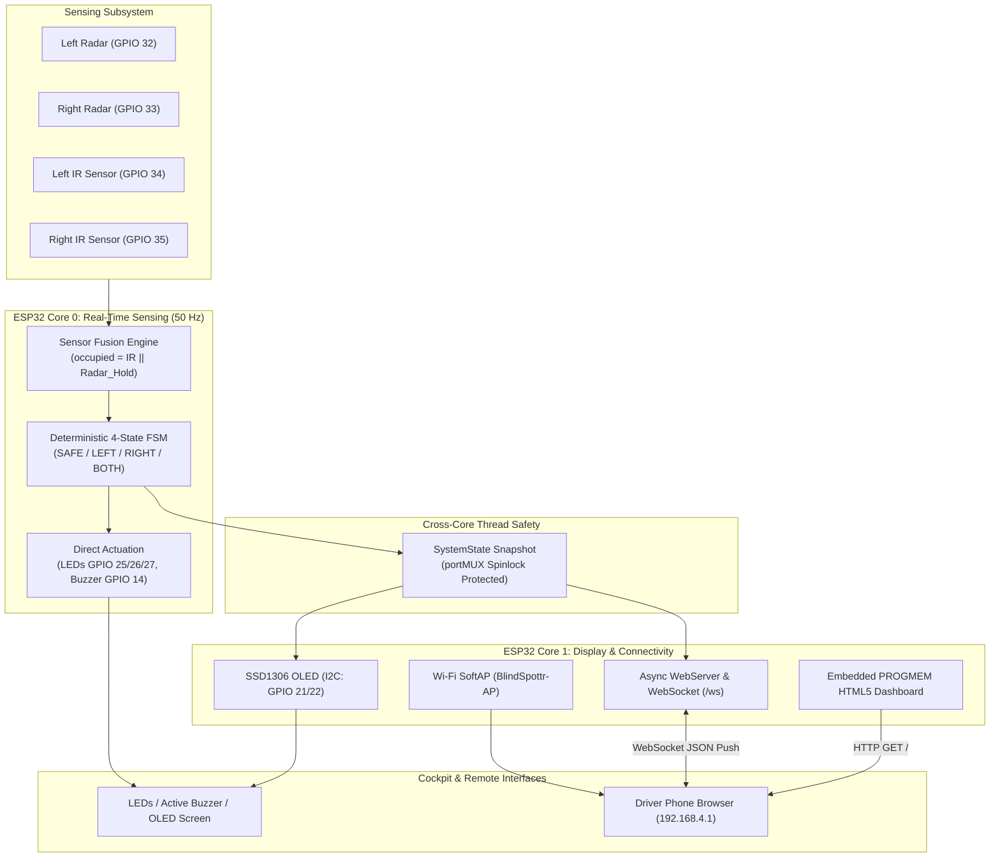
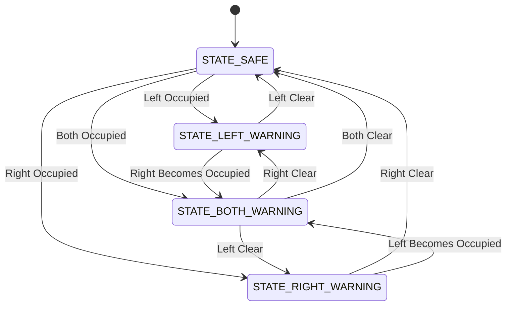

# BlindSpottr — Intelligent Blind-Spot Monitoring

[](https://platformio.org/)
[](https://www.espressif.com/en/products/socs/esp32)
[-green.svg)](https://github.com/espressif/arduino-esp32)
[](https://www.freertos.org/)
[]()

> **BlindSpottr** is an intelligent, embedded automotive blind-spot monitoring prototype developed for an ESP32-powered vehicle. It fuses microwave Doppler radar with optical infrared presence sensing to eliminate blind-spot dropouts when vehicles stop, delivering real-time alerts via cockpit indicators, an I2C OLED display, and a zero-dependency wireless mobile dashboard.

---

## System Overview

Conventional low-cost blind-spot warning systems suffer from a major design flaw:
* **Radar-only systems** detect moving objects via Doppler frequency shift, but lose tracking immediately when a vehicle stops in the blind spot.
* **Optical/Ultrasonic systems** have narrow cones and miss high-speed approaches from behind.

**BlindSpottr** solves this through **heterogeneous multi-sensor fusion**:
1. **2× RCWL-0516 Microwave Radars** provide wide-angle early warning for approaching vehicles.
2. A **3000 ms Software Hold Window** latches the radar trigger to bridge vehicle deceleration.
3. **2× Infrared Obstacle Sensors** confirm persistent presence when a vehicle comes to a complete halt beside the car.

```text
Moving / Approaching Vehicle
            ↓
     RCWL-0516 RADAR
            ↓
     Early Alert (Hold Active)
            ↓
      Vehicle Halts
            ↓
        IR SENSOR
            ↓
   Continuous Warning Maintained
```

---

## System Architecture

The ESP32 dual-core Xtensa LX6 architecture physically separates real-time safety sensing from wireless telemetry to guarantee zero-latency alert actuation.



---

## Hardware Pinout & Wiring

All pin definitions are centralized in `include/config.h`:

| Subsystem | Signal Name | ESP32 GPIO | Direction | Electrical / Pin Notes |
| :--- | :--- | :--- | :--- | :--- |
| **Radar Left** | `PIN_RADAR_L` | **GPIO 32** | Digital Input | Active-HIGH Doppler pulse from RCWL-0516 |
| **Radar Right** | `PIN_RADAR_R` | **GPIO 33** | Digital Input | Active-HIGH Doppler pulse from RCWL-0516 |
| **IR Left** | `PIN_IR_L` | **GPIO 34** | Digital Input | **Input-only (GPI)**. Active-LOW obstacle detection |
| **IR Right** | `PIN_IR_R` | **GPIO 35** | Digital Input | **Input-only (GPI)**. Active-LOW obstacle detection |
| **LED Left (Red)** | `PIN_LED_L` | **GPIO 25** | Digital Output | Active-HIGH push-pull with 330Ω resistor |
| **LED Right (Red)**| `PIN_LED_R` | **GPIO 26** | Digital Output | Active-HIGH push-pull with 330Ω resistor |
| **LED Safe (Green)**| `PIN_LED_SAFE`| **GPIO 27** | Digital Output | Active-HIGH push-pull. Lit during `STATE_SAFE` |
| **Active Buzzer** | `PIN_BUZZER` | **GPIO 14** | Digital Output | Active-HIGH transistor-driven alert tones |
| **OLED SDA** | `PIN_I2C_SDA` | **GPIO 21** | I2C Data | 3.3V logic, SSD1306 I2C address `0x3C` |
| **OLED SCL** | `PIN_I2C_SCL` | **GPIO 22** | I2C Clock | 3.3V logic, 400 kHz Fast Mode |

*Hardware Safety Notes:*
* Strapping pins (`GPIO 0, 2, 12, 15`) are strictly avoided to prevent flash boot loops.
* GPIO 34 & 35 are silicon input-only pins without internal pull-ups; external pull-ups on IR modules are required.

---

## Deterministic State Machine

The system resolves into exactly four mutually exclusive states evaluated every 20 ms:



| State | Green Safe LED | Red Alert LEDs | Active Buzzer | 128×64 OLED Screen | Mobile Dashboard |
| :--- | :--- | :--- | :--- | :--- | :--- |
| **`STATE_SAFE` (0)** | **ON** | Both OFF | Silent | `[ SYSTEM CLEAR ]` | Green status, neutral silhouette |
| **`STATE_LEFT_WARNING` (1)** | OFF | Left Pulsed | 120ms Beep Pulse | `<<< LEFT HAZARD <<<` | Left zone highlighted Amber/Red |
| **`STATE_RIGHT_WARNING` (2)** | OFF | Right Pulsed | 120ms Beep Pulse | `>>> RIGHT HAZARD >>>` | Right zone highlighted Amber/Red |
| **`STATE_BOTH_WARNING` (3)** | OFF | Both Solid ON | Rapid Urgent Beep | `<<< DUAL HAZARD >>>` | Dual flashing red warning zones |

---

## Web Dashboard & Telemetry

The mobile dashboard is delivered directly from the ESP32 without an internet connection:
* **Wi-Fi Access Point:** Broadcasts SSID `BlindSpottr-AP` (IP `192.168.4.1`).
* **Zero Flash Dependencies:** Complete HTML5/CSS3/JavaScript single-page app embedded in **PROGMEM** (`src/network/dashboard_html.h`). No LittleFS/SPIFFS filesystem flashing required.
* **WebSocket Push (`/ws`):** Real-time JSON telemetry pushed upon state change or 200 ms heartbeat:
  ```json
  {
    "state": 1,
    "left": true,
    "right": false,
    "radarL": true,
    "radarR": false,
    "irL": false,
    "irR": false,
    "uptime": 14250
  }
  ```

---

## Project Structure

```text
BlindSpottr/
├── AGENTS.md                 # Master AI coding agent engineering rules & Git protocol
├── hs.md                     # Rapid orientation and handoff summary
├── README.md                 # Project overview and hardware reference
├── TODO.md                   # Phased 8-stage implementation roadmap
├── PROGRESS.md               # Verified state, audit records, and next actions
├── docs/
│   ├── flow.md               # Authoritative technical specification & truth
│   ├── architecture.md       # Detailed subsystem diagrams & concurrency models
│   ├── design.md             # System design, state semantics & electrical safety
│   └── implementation.md     # Modular firmware APIs & FreeRTOS task models
├── platformio.ini            # PlatformIO environment & library configuration
├── include/
│   └── config.h              # Centralized hardware pinouts & parameters
├── src/
│   ├── main.cpp              # Startup sequence, Core 0 FreeRTOS task, Core 1 loop
│   ├── sensors/              # Radar and IR sensor drivers with hold latching
│   ├── logic/                # Pure boolean fusion engine & 4-state machine
│   ├── outputs/              # Non-blocking LED, buzzer, and OLED drivers
│   └── network/              # SoftAP, AsyncWebServer, WebSocket & PROGMEM UI
└── test/                     # Unity host & target unit test suites
```

---

## Getting Started & Build Instructions

### Prerequisites
* [VS Code](https://code.visualstudio.com/) with the **PlatformIO IDE** extension installed.
* Alternatively, PlatformIO Core CLI:
  ```bash
  pip install platformio
  ```

### Build & Verification
1. Clone the repository:
   ```bash
   git clone https://github.com/devinfinix/BlindSpottr.git
   cd BlindSpottr
   ```
2. Build the firmware using PlatformIO:
   ```bash
   pio run
   ```
3. Connect the ESP32 via micro-USB and upload:
   ```bash
   pio run -t upload
   ```
4. Monitor serial output:
   ```bash
   pio device monitor -b 115200
   ```

---

## Documentation Authority Hierarchy

All engineering work must strictly follow the priority order established in `AGENTS.md`:
1. **`AGENTS.md`**: Master agent execution, safety, and Git/GitHub procedures.
2. **`docs/flow.md`**: Authoritative system specification and hardware truth.
3. **`docs/architecture.md`**: Concurrency, data flow, and subsystem models.
4. **`docs/design.md`**: State transitions and electrical boundaries.
5. **`docs/implementation.md`**: Module APIs and FreeRTOS task structures.
6. **`TODO.md`**: Phased task roadmap and acceptance criteria.
7. **`PROGRESS.md`**: Verified current state and handoff notes.
8. **`hs.md`**: Rapid orientation.
9. **`README.md`**: Public-facing overview.

---

## Development Status & Roadmap

| Stage | Milestone | Status |
| :--- | :--- | :--- |
| **Phase 0** | **Reconnaissance & Engineering Foundation** | **Completed** |
| **Phase 1** | **PlatformIO Foundation & Pin Configuration** | In Progress |
| **Phase 2** | **Sensor Abstractions & Non-Blocking Hold** | Pending |
| **Phase 3** | **Sensor Fusion & 4-State Machine** | Pending |
| **Phase 4** | **Cockpit Actuation (LEDs, Buzzer, OLED)** | Pending |
| **Phase 5** | **FreeRTOS Concurrency & Dual-Core Task** | Pending |
| **Phase 6** | **Wi-Fi SoftAP & PROGMEM Dashboard** | Pending |
| **Phase 7** | **System Integration & Hardware Bring-Up** | Pending |
| **Phase 8** | **CI Automation & Release Preparation** | Pending |

---

## License

This project is open-source under the [MIT License](LICENSE).
