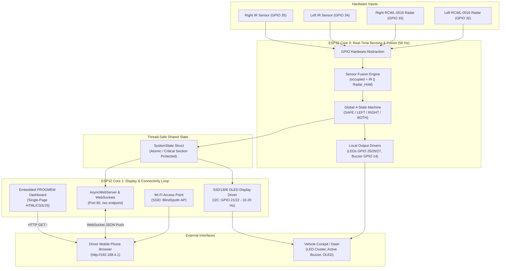
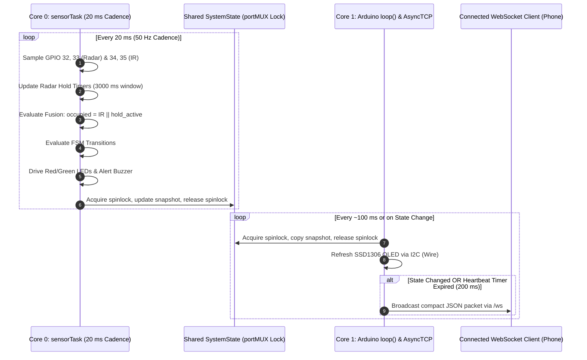
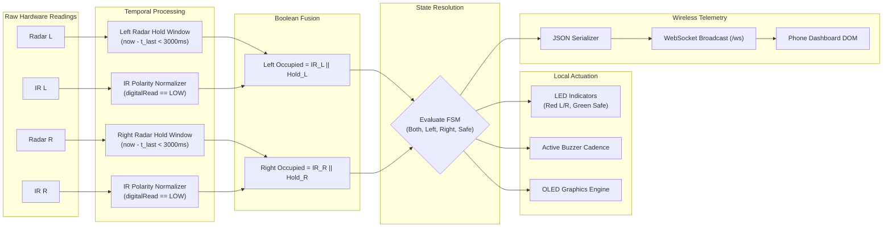
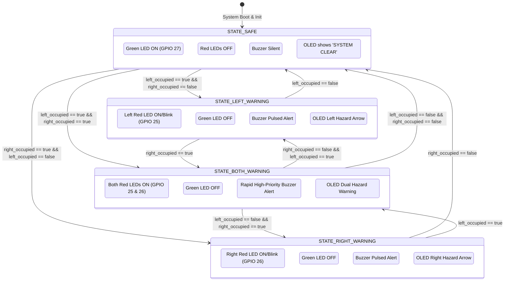

# BlindSpottr — System Architecture Specification

> **AUTHORITY:** This document details the hardware and software architecture of the BlindSpottr system. For operational agent rules, see `AGENTS.md`. For authoritative technical requirements and pinouts, see `docs/flow.md`.

---

## 1. System Architecture Overview

BlindSpottr is an intelligent, dual-core embedded monitoring system implemented on an Espressif ESP32 microcontroller (`esp32doit-devkit-v1`). The architecture is split across hardware sensing, real-time sensor fusion, local alert actuation, and an isolated wireless telemetry pipeline.



---

## 2. Concurrency and Dual-Core Execution Model

The ESP32 dual-core Xtensa LX6 architecture is leveraged to physically separate high-priority, jitter-free real-time sensing from network-induced latency and non-deterministic I/O.



### 2.1 Core Allocation
- **Core 0 — Deterministic Real-Time Sensing (`sensorTask`):**
  - Priority: `tskIDLE_PRIORITY + 3` (high priority).
  - Pinned to Core 0 using `xTaskCreatePinnedToCore`.
  - Timing: Fixed 20 ms cadence (50 Hz) regulated by `vTaskDelayUntil()`.
  - Responsibilities: Digital pin reads, software radar hold-timer evaluation, sensor fusion logic, FSM state updates, and direct GPIO output control (LEDs, active buzzer).
- **Core 1 — Communication and Display (`loopTask`):**
  - Priority: Default Arduino `setup()` and `loop()`.
  - Responsibilities: Wi-Fi SoftAP stack, ESPAsyncWebServer request routing, AsyncTCP WebSocket broadcast handling, client connection life-cycle, and I2C OLED display refresh (10–20 Hz).

### 2.2 Cross-Core Thread Safety
Access to the shared `SystemState` structure must never block Core 0.
- Synchronization Mechanism: FreeRTOS `portMUX_TYPE` spinlock (`taskENTER_CRITICAL()` / `taskEXIT_CRITICAL()`) or C++11 `std::atomic` fields.
- Zero Mutexes: Heavy FreeRTOS mutexes (`xSemaphoreCreateMutex`) that can cause priority inversion or task suspension are strictly forbidden on the 20 ms sensing path.

---

## 3. Data Flow Architecture

The data pipeline progresses from raw physical sensor events to fused semantic states, then branches into cockpit alert outputs and remote telemetry.



---

## 4. Finite State Machine (FSM) Architecture

The system operates a deterministic 4-state Mealy/Moore hybrid state machine. The current state is resolved every 20 ms based on fused occupancy flags.



---

## 5. Subsystem Component Architecture

### 5.1 Sensing Subsystem
- **Module Path:** `src/sensors/` (`radar.h`, `radar.cpp`, `ir.h`, `ir.cpp`).
- **Interfaces:** `void sensors_init()`, `void sensors_read(RawSensorData &out)`.
- **Hardware Decoupling:** Hardware pins and polarities are injected from `config.h`. No hardcoded GPIO accesses exist inside processing routines.

### 5.2 Fusion & State Machine Subsystem
- **Module Path:** `src/logic/` (`fusion.h`, `fusion.cpp`, `state_machine.h`, `state_machine.cpp`).
- **Interfaces:** `SystemState fusion_update(const RawSensorData &raw, uint32_t now)`.
- **Pure Logic:** Contains no direct hardware GPIO or display calls, enabling 100% unit-testability on host platforms or Unity simulators.

### 5.3 Local Actuation Subsystem
- **Module Path:** `src/outputs/` (`indicators.h`, `indicators.cpp`, `buzzer.h`, `buzzer.cpp`, `display.h`, `display.cpp`).
- **LED/Buzzer Driver:** Evaluates current state and manages non-blocking blinking/pulsing cadences using elapsed time checks.
- **OLED Display Driver:** Formats hazard icons, radar/IR activity badges, and system uptime into SSD1306 buffer over 400 kHz I2C.

### 5.4 Wireless & Web Subsystem
- **Module Path:** `src/network/` (`wifi_manager.h`, `wifi_manager.cpp`, `web_server.h`, `web_server.cpp`, `dashboard_html.h`).
- **SoftAP Configuration:** IP `192.168.4.1`, Subnet `255.255.255.0`, SSID `BlindSpottr-AP`, WPA2 Passphrase configured in `config.h`.
- **Embedded PROGMEM Dashboard:** Complete HTML5/CSS3/JavaScript web application stored as an escaped `const char DASHBOARD_HTML[] PROGMEM` string inside `dashboard_html.h`. Zero external filesystem partitions (SPIFFS/LittleFS) required.
- **WebSocket Protocol:** Endpoint `/ws`. Dispatches telemetry as JSON strings:
  ```json
  {"state":1,"left":true,"right":false,"radarL":true,"radarR":false,"irL":false,"irR":false,"uptime":12450}
  ```
