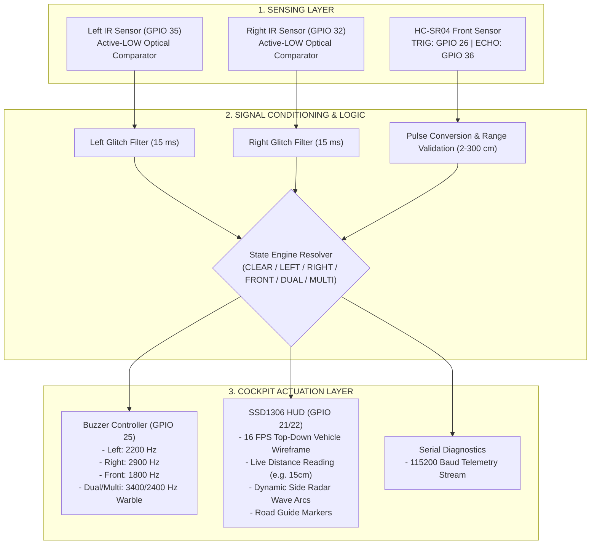

# BlindSpottr: System Architecture and Hardware Wiring

This document illustrates the complete physical and functional architecture of the BlindSpottr prototype, including a 2D wiring layout, pin-by-pin hardware mapping, signal data flows, and firmware structure.

---

## 1. 2D Physical Layout and Component Wiring

Below is a 2D visual representation of the ESP32 microcontroller board and all connected peripheral components. It details the exact verified physical wiring of the dual IR presence sensors, cockpit buzzer, SSD1306 OLED, and the HC-SR04 ultrasonic sensor.

```text
 ┌─────────────────────────┐                                 ┌─────────────────────────┐
 │   LEFT IR SENSOR        │                                 │   RIGHT IR SENSOR       │
 │   (TCRT5000 / LM393)    │                                 │   (TCRT5000 / LM393)    │
 │  ┌───────────────────┐  │                                 │  ┌───────────────────┐  │
 │  │ [VCC] [GND] [DO]  │  │                                 │  │ [VCC] [GND] [DO]  │  │
 └──┴───┬─────┬────┬────┴──┘                                 └──┴───┬─────┬────┬────┴──┘
        │     │    │                                                │     │    │
        │     │    └──────────────────────────────────────┐         │     │    │
        │     │                                           │         │     │    │
        │     │    ┌──────────────────────────────────────┴─────────┼─────┼────┘
        │     │    │            ESP32 DEVKIT V1                     │     │
        │     │    │               (38-PIN)                         │     │
        │     │    │                                                │     │
        │     │    │  [VIN] ──────── 5V DC Supply Rail ─────────────┼─────┤
        │     │    │  [3V3] ──────── 3.3V DC Logic Rail ────────────┼─────┤
        │     │    │  [GND] ──────── Common Ground Rail ────────────┼─────┤
        │     │    │                                                │     │
        │     └────┤► [GND]                            [GPIO 22] ◄──┼─────┼───────┐ (SCL)
        └──────────┤► [3V3]                            [GPIO 21] ◄──┼─────┼───┐   │ (SDA)
                   │  [GPIO 35] ◄── (Left DO)          [GPIO 25] ───┼─────┼─┐ │   │   │ (Tone)
                   │  [GPIO 32] ◄── (Right DO)         [GPIO 26] ───┼─────┼─┼─┼───┼───┼─────┐ (TRIG)
                   │  [GPIO 36] ◄── (ECHO Pulse)       [GND]        │     │ │ │   │   │     │
                   └──────────────────▲─────────────────────────────┘     │ │ │   │   │     │
                                      │                                   │ │ │   │   │     │
                                      │                                   │ │ │   │   │     │
             ┌────────────────────────┘                                   │ │ │   │   │     │
             │                                                            │ │ │   │   │     │
             ▼                                                            ▼ ▼ ▼   ▼   ▼     ▼
 ┌─────────────────────────┐                              ┌─────────────────────────┐ ┌─────────────────────────┐
 │   BUZZER MODULE         │                              │   SSD1306 OLED (128x64) │ │   HC-SR04 ULTRASONIC    │
 │   (Active or Passive)   │                              │   (I2C Display)         │ │   (Front Headway)       │
 │  ┌───────────────────┐  │                              │  ┌───────────────────┐  │ │  ┌───────────────────┐  │
 │  │ [GND] [VCC] [SIG] │  │                              │  │[GND] [VCC] [SCL] [SDA│ │  │[VCC] [TRIG][ECHO][GND]│
 └──┴───┬─────┬─────▲───┴──┘                              └──┴──┬─────┬─────▲─────▲─┘ └──┴──┬─────▲─────┬────┬───┘
        │     │     │ (GPIO 25 PWM)                             │     │     │     │         │     │     │    │
        │     └─────┼──────────────── 3.3V Rail ────────────────┼─────┘     │     │         │     │     │    │
        └───────────┼──────────────── Ground Rail ──────────────┴───────────┼─────┼─────────┼─────┼─────┼────┘
                    │                                                       │     │         │     │     │
                    │                                                       │     │    (5V) ┘     │     │
                    │                                                       │     │               │     │
                    │                      (ESP32 GPIO 21 SDA) ─────────────┼─────┘               │     │
                    │                      (ESP32 GPIO 22 SCL) ─────────────┘                     │     │
                    │                                                                             │     │
                    └─────────────────────────────────────────────────────────────────────────────┼─────┘
                                           (ESP32 GPIO 26 Trigger Pulse) ─────────────────────────┘
```

---

## 2. Complete Pin Assignment Matrix

| ESP32 Pin | Function | Peripheral | Pin on Peripheral | Logic Level | Electrical Notes |
| :--- | :--- | :--- | :--- | :--- | :--- |
| **GPIO 35** | Digital Input | Left IR Sensor | DO (Digital Out) | 3.3V Logic | Input-only (GPI). Active-LOW optical comparator. |
| **GPIO 32** | Digital Input | Right IR Sensor | DO (Digital Out) | 3.3V Logic | Digital Input with pull-up capability. Active-LOW. |
| **GPIO 26** | Digital Output | Ultrasonic Sensor | TRIG | 3.3V Output | Generates 10µs ultrasonic start pulse. |
| **GPIO 36 (VP)**| Digital Input | Ultrasonic Sensor | ECHO | ~3.3V Input | Input-only (GPI). Reads echo pulse width. |
| **GPIO 25** | PWM Output | Cockpit Buzzer | SIG / I/O | 3.3V PWM | Driven by LEDC Channel 0 (8-bit multi-frequency tone). |
| **GPIO 21** | I2C Data | SSD1306 OLED | SDA | 3.3V Logic | ESP32 hardware Wire data line. 400 kHz fast mode. |
| **GPIO 22** | I2C Clock | SSD1306 OLED | SCL | 3.3V Logic | ESP32 hardware Wire clock line. 400 kHz fast mode. |
| **VIN** | 5V Power | HC-SR04 | VCC | 5V DC | 5V power supply from USB bus. |
| **3V3** | 3.3V Power | IR & OLED & Buzzer | VCC | 3.3V DC | Regulated onboard 3.3V logic rail. |
| **GND** | Ground | All peripherals | GND | 0V Reference | Common reference ground shared across all components. |

---

## 3. End-to-End Functional Architecture


