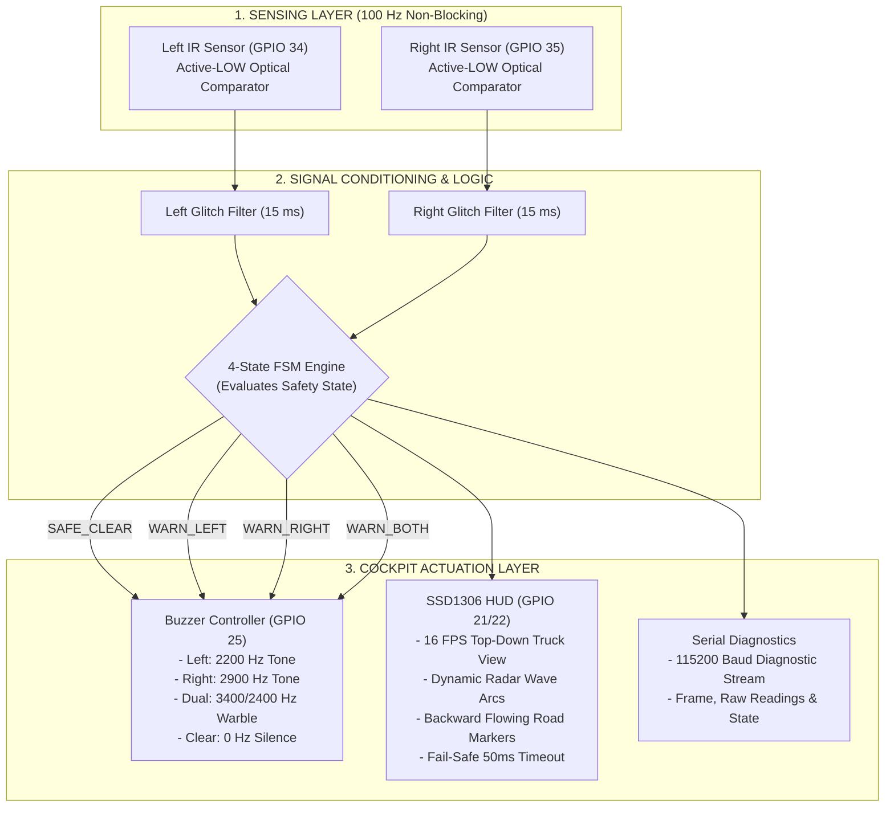
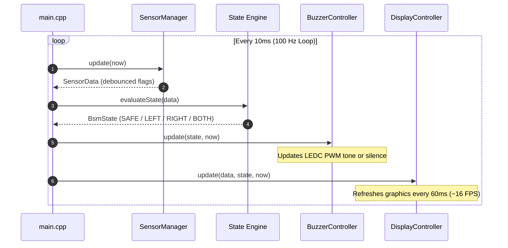

# BlindSpottr: System Architecture and Hardware Wiring

This document illustrates the complete physical and functional architecture of the BlindSpottr prototype, including a 2D wiring layout, pin-by-pin hardware mapping, signal data flows, and firmware structure.

---

## 1. 2D Physical Layout and Component Wiring

Below is a 2D visual representation of the ESP32 microcontroller board and all connected peripheral components. It shows how the hardware modules wire into the specific header pins of the 38-pin DevKit V1.

```text
 ┌─────────────────────────┐                                 ┌─────────────────────────┐
 │   LEFT IR SENSOR        │                                 │   RIGHT IR SENSOR       │
 │   (TCRT5000 / LM393)    │                                 │   (TCRT5000 / LM393)    │
 │  ┌───────────────────┐  │                                 │  ┌───────────────────┐  │
 │  │ [VCC] [GND] [DO]  │  │                                 │  │ [VCC] [GND] [DO]  │  │
 └──┴───┬─────┬────┬────┴──┘                                 └──┴───┬─────┬────┬────┴──┘
        │     │    │                                                │     │    │
        │     │    └───────────────────────┐   ┌────────────────────┼─────┼────┘
        │     │                            │   │                    │     │
        │     │    ┌───────────────────────┴───┴────────────────┐   │     │
        │     │    │            ESP32 DEVKIT V1                 │   │     │
        │     │    │               (38-PIN)                     │   │     │
        │     │    │                                            │   │     │
        │     │    │  [3V3] ──────── Power (3.3V) Rail ─────────┼───┤     │
        │     │    │  [GND] ──────── Common Ground Rail ────────┼───┼─────┤
        │     │    │                                            │   │     │
        │     └────┤► [GND]                        [GPIO 22] ◄──┼───┼─────┼───────┐ (SCL)
        └──────────┤► [3V3]                        [GPIO 21] ◄──┼───┼─────┼───┐   │ (SDA)
                   │  [GPIO 34] ◄── (Left DO)      [GPIO 25] ───┼───┼─┐   │   │   │ (Tone)
                   │  [GPIO 35] ◄── (Right DO)     [GND]        │   │ │   │   │   │
                   │                                            │   │ │   │   │   │
                   └────────────────────────────────────────────┘   │ │   │   │   │
                                                                    │ │   │   │   │
             ┌──────────────────────────────────────────────────────┘ │   │   │   │
             │                                                        │   │   │   │
             ▼                                                        ▼   ▼   ▼   ▼
 ┌─────────────────────────┐                                ┌─────────────────────────┐
 │   BUZZER MODULE         │                                │   SSD1306 OLED (128x64) │
 │   (Active or Passive)   │                                │   (I2C Display)         │
 │  ┌───────────────────┐  │                                │  ┌───────────────────┐  │
 │  │ [GND] [VCC] [SIG] │  │                                │  │[GND] [VCC] [SCL] [SDA]
 └──┴───┬─────┬─────▲───┴──┘                                └──┴──┬─────┬─────▲─────▲─┘
        │     │     │ (GPIO 25 PWM)                               │     │     │     │
        │     └─────┼──────────────── 3.3V Rail ──────────────────┼─────┘     │     │
        └───────────┼──────────────── Ground Rail ────────────────┘           │     │
                    │                                                         │     │
                    └─────────────────────────────────────────────────────────┼─────┘
                                                                              │
                                       (ESP32 GPIO 22 Clock) ─────────────────┘
```

---

## 2. Complete Pin Assignment Matrix

The following table details every active and reserved connection on the ESP32 board:

| ESP32 Pin | Function | Peripheral | Pin on Peripheral | Voltage Logic | Details / Notes |
| :--- | :--- | :--- | :--- | :--- | :--- |
| **GPIO 34** | Digital Input | Left IR Module | DO (Digital Out) | 3.3V Logic | Input-only pin (GPI). Active-LOW detection signal. |
| **GPIO 35** | Digital Input | Right IR Module | DO (Digital Out) | 3.3V Logic | Input-only pin (GPI). Active-LOW detection signal. |
| **GPIO 25** | PWM Output | Cockpit Buzzer | SIG / I/O | 3.3V PWM | Driven by LEDC Channel 0 (8-bit resolution, multi-tone). |
| **GPIO 21** | I2C Data | SSD1306 OLED | SDA | 3.3V Logic | ESP32 default hardware I2C data line. 400 kHz fast mode. |
| **GPIO 22** | I2C Clock | SSD1306 OLED | SCL | 3.3V Logic | ESP32 default hardware I2C clock line. 400 kHz fast mode. |
| **GPIO 26** | Digital Output | Ultrasonic (Optional) | TRIG | 3.3V Logic | Reserved for optional HC-SR04 front sensor. |
| **GPIO 36** | Digital Input | Ultrasonic (Optional) | ECHO | 3.3V (Divided) | Reserved for optional HC-SR04 front sensor (requires divider). |
| **3V3** | Power Output | All modules | VCC | 3.3V DC | Regulated onboard 3.3V supply rail. |
| **GND** | Ground | All modules | GND | 0V Reference | Common reference ground rail across all modules. |

---

## 3. End-to-End Functional Architecture



---

## 4. Software Subsystems and Execution Flow

The firmware is structured into four cooperative, non-blocking subsystems that run sequentially on each pass of the main `loop()`:



### Subsystem Breakdown:
1. **SensorManager (`src/sensors.h / .cpp`)**:
   - Reads GPIO 34 and GPIO 35.
   - Applies an asynchronous 15 ms debounce window so mechanical vibrations or quick flickers do not disrupt warning states.
2. **State Engine (`src/main.cpp`)**:
   - Pure deterministic resolution. Evaluates whether both sides, one side, or no sides are obstructed.
3. **BuzzerController (`src/buzzer.h / .cpp`)**:
   - Manages an ESP32 LEDC timer channel on GPIO 25.
   - Generates clean square-wave acoustic frequencies with zero CPU overhead once started.
   - Immediately cuts power when returning to `SAFE_CLEAR` state.
4. **DisplayController (`src/display.h / .cpp`)**:
   - Renders animated top-down pixel art on the SSD1306 monochrome screen at approximately 16 frames per second.
   - Operates in 400 kHz fast I2C mode. Employs hardware bus timeout handling to guarantee the main loop never halts if the screen is disconnected.
