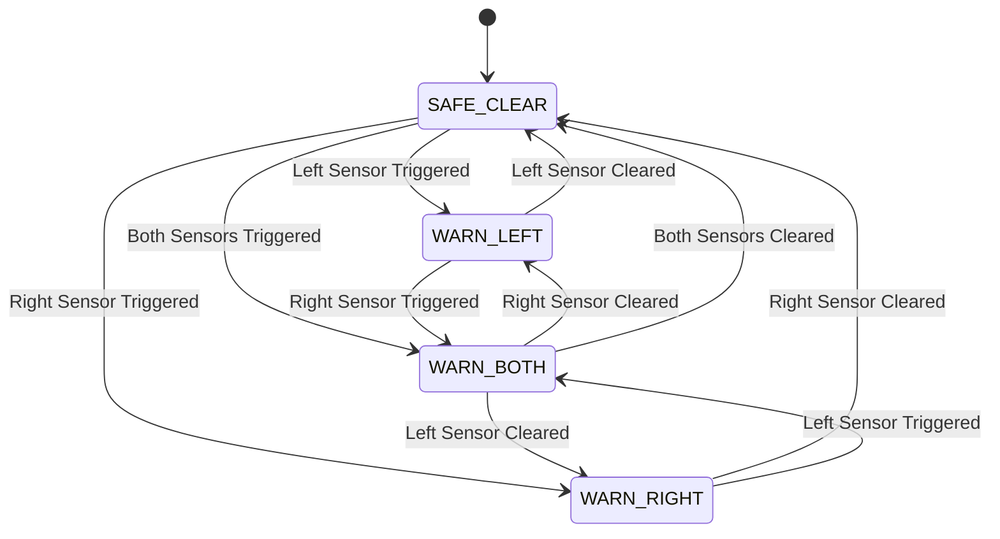

# BlindSpottr: Detailed System Design Specification

This document details the engineering decisions, state machine semantics, visual HUD design, and acoustic choices implemented in BlindSpottr.

---

## 1. Design Intent & Problem Statement

### 1.1 The Blind-Spot Problem
Vehicle blind spots present a severe safety risk during lane merges and turns. In miniature vehicle prototypes and educational robotics:
- Basic obstacle detection code frequently uses `delay()`, which halts execution, starves sensor polling, and freezes screen updates.
- Standard projects often use simple, single-tone buzzers that produce monotonous buzzing, making it impossible for a driver to distinguish which side is blocked without looking away from the road.

### 1.2 The BlindSpottr Solution
BlindSpottr implements a responsive, non-blocking architecture:
- **Asynchronous 100 Hz Sampling**: Uses `millis()` delta timers to poll presence sensors without holding the CPU.
- **Directional Sound Design**: Uses hardware PWM to generate distinct musical pitches for Left (2200 Hz) and Right (2900 Hz), along with an alternating warble for Dual hazards.
- **Animated Top-Down HUD**: Provides immediate visual awareness using a pixel-art truck model flanked by dynamic radar waves and flowing road guidelines.

---

## 2. Sensor Operation & Electrical Rules

### 2.1 Infrared Reflection Sensors (TCRT5000 / LM393)
- **Principle**: An infrared emitter diode sends out optical pulses. When an object enters the detection threshold (typically 2 to 15 cm, adjustable via the onboard potentiometer), reflected light triggers a phototransistor, causing the comparator output (DO) to pull LOW.
- **Active Level**: Active-LOW (`LOW = Object detected`, `HIGH = Zone clear`).
- **ESP32 Silicon Constraint**: Wired to GPIO 34 (Left) and GPIO 35 (Right). Both pins are input-only (GPI) and lack internal software pull-ups. The module's onboard pull-up resistor provides the default HIGH signal level.

---

## 3. Finite State Machine (FSM)

The system operates across four primary states resolved on every loop pass:



### State Definitions:
1. **`BsmState::SAFE_CLEAR`**:
   - Both sensors read clear (`HIGH`).
   - Buzzer: completely silent (0 Hz).
   - Display: road guidelines stream backward past the truck; bottom banner displays `>>> ROAD CLEAR <<<`.
2. **`BsmState::WARN_LEFT`**:
   - Left sensor detects an obstacle; Right sensor is clear.
   - Buzzer: 2200 Hz tone pulsed at 100 ms ON / 120 ms OFF.
   - Display: animated radar arcs emit left; inverted `[!] L` badge illuminates; header chevrons sweep left; bottom banner displays `<< LEFT HAZARD! <<`.
3. **`BsmState::WARN_RIGHT`**:
   - Right sensor detects an obstacle; Left sensor is clear.
   - Buzzer: 2900 Hz tone pulsed at 100 ms ON / 120 ms OFF.
   - Display: animated radar arcs emit right; inverted `[!] R` badge illuminates; header chevrons sweep right; bottom banner displays `>> RIGHT HAZARD! >>`.
4. **`BsmState::WARN_BOTH`**:
   - Both sensors detect obstacles simultaneously.
   - Buzzer: rapid two-tone warble alarm switching between 3400 Hz and 2400 Hz every 50 ms.
   - Display: radar arcs pulse on both sides; flashing alternating banner displays `!! DUAL SIDE WARN !!`.

---

## 4. Acoustic Pitch and Cadence Engineering

Using the ESP32 LEDC PWM controller on GPIO 25, the buzzer driver produces clean square waves without CPU overhead:

| State | Pitch (Hz) | Duration On | Duration Off | Rationale |
| :--- | :---: | :---: | :---: | :--- |
| **Clear** | 0 Hz | 0 ms | Indefinite | Cockpit silence during safe conditions. |
| **Left Hazard** | 2200 Hz | 100 ms | 120 ms | Steady mid-pitch tone easily associated with the left side. |
| **Right Hazard** | 2900 Hz | 100 ms | 120 ms | Sharper, higher frequency tone easily distinguished from the left. |
| **Dual Hazard** | 3400 / 2400 Hz | 50 ms | 50 ms | High-urgency alternating chirp signaling high priority. |

---

## 5. Visual HUD Layout (SSD1306 OLED)

The screen is updated every 60 ms (~16 FPS) over I2C at 400 kHz.

```text
0-----------------------------------------------------127
| <<<           B L I N D S P O T T R               >>> | (Y: 0-9)
|-------------------------------------------------------|
|               [== Front Scanner ==]                   | (Y: 10-14)
|  [!]L       .-----.  [====]  .-----.            [!]R  | (Y: 14-46)
|  ((((       |     |  |    |  |     |            ))))  |
|             '-----'  |____|  '-----'                  |
|                        ||                             |
|                      [====]                           |
|-------------------------------------------------------|
|               << LEFT HAZARD DETECTED <<              | (Y: 50-63)
+-------------------------------------------------------+
```

- **Top-Down Perspective**: Mirrors the driver's perspective from above the vehicle.
- **Fail-Safe Operation**: If the display is disconnected, the 50 ms I2C timeout allows the ESP32 to drop the frame without blocking sensor reads or audio alerts.
