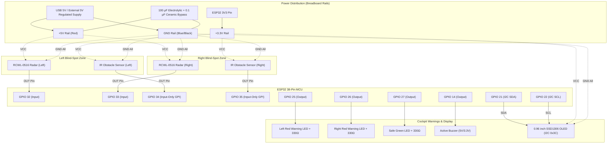
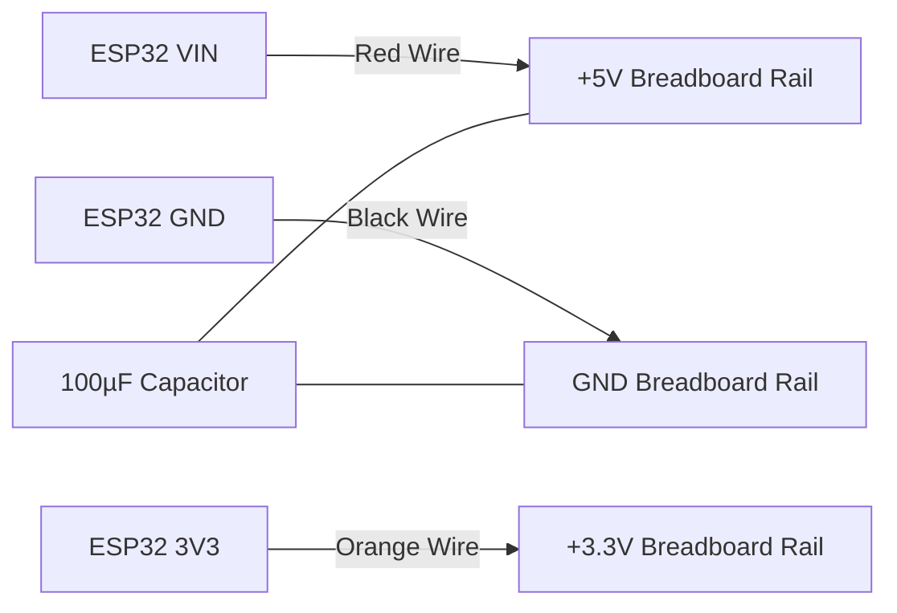

# BlindSpottr — Live Hardware Wiring & Physical Testing Guide

> **AUTHORITY:** This document provides the live step-by-step physical wiring instructions, electrical constraints, and bench test procedures for **BlindSpottr**.
>
> *Updated with each firmware milestone to match current firmware pin definitions and testing capabilities.*

---

## 1. Master Breadboard & Wiring Architecture

The system connects to an **ESP32 38-Pin Development Board (DevKit V1)**.

---

## 2. Pin-by-Pin Hardware Connection Table

| Peripheral | Module Pin | ESP32 GPIO / Rail | Wire Color (Rec.) | Notes & Electrical Safety |
| :--- | :--- | :--- | :--- | :--- |
| **Power In** | Micro-USB | PC / 5V USB Power | - | Provides regulated 5V to DevKit Vin |
| **Power Rails** | ESP32 `VIN` / `5V` | Breadboard Red Rail | Red | Powers Radar modules and Buzzer |
| | ESP32 `3V3` | Breadboard +3.3V Rail | Orange | Powers IR sensors and OLED (3.3V logic) |
| | ESP32 `GND` | Breadboard Blue Rail | Black | Common Ground for all components |
| **Left Radar** | `VIN` / `5V` | +5V Rail | Red | RCWL-0516 requires >4.0V VCC |
| (RCWL-0516) | `GND` | GND Rail | Black | |
| | `OUT` | **GPIO 32** | Yellow | 3.3V digital pulse (Active-HIGH) |
| **Right Radar**| `VIN` / `5V` | +5V Rail | Red | |
| (RCWL-0516) | `GND` | GND Rail | Black | |
| | `OUT` | **GPIO 33** | White | 3.3V digital pulse (Active-HIGH) |
| **Left IR** | `VCC` | +3.3V Rail | Orange | 3.3V recommended to protect ESP32 inputs |
| (LM393 module)| `GND` | GND Rail | Black | |
| | `OUT` | **GPIO 34** | Blue | Input-only pin (GPI). Active-LOW |
| **Right IR** | `VCC` | +3.3V Rail | Orange | |
| (LM393 module)| `GND` | GND Rail | Black | |
| | `OUT` | **GPIO 35** | Green | Input-only pin (GPI). Active-LOW |
| **Left Red LED**| Anode (+) | **GPIO 25** | Red | In series with 220Ω / 330Ω resistor to GND |
| | Cathode (-) | GND Rail | Black | Flat edge / shorter leg to GND |
| **Right Red LED**| Anode (+) | **GPIO 26** | Red | In series with 220Ω / 330Ω resistor to GND |
| | Cathode (-) | GND Rail | Black | |
| **Safe Green LED**| Anode (+) | **GPIO 27** | Green | In series with 220Ω / 330Ω resistor to GND |
| | Cathode (-) | GND Rail | Black | Lit when system is in `STATE_SAFE` |
| **Active Buzzer**| Positive (+) | **GPIO 14** | Purple | Direct drive or NPN transistor drive |
| | Negative (-) | GND Rail | Black | |
| **OLED Display**| `VCC` | +3.3V Rail | Orange | 3.3V logic power |
| (SSD1306 0.96")| `GND` | GND Rail | Black | |
| | `SDA` | **GPIO 21** | Brown | Default ESP32 hardware I2C Data |
| | `SCL` | **GPIO 22** | Gray | Default ESP32 hardware I2C Clock |

---

## 3. Step-by-Step Hardware Assembly Checklist

### Step 1: Power & Ground Rails Setup
1. Insert the ESP32 38-Pin DevKit into the breadboard so it straddles the center divider.
2. Connect `GND` pin on the ESP32 to the breadboard blue/black negative power rail.
3. Connect `VIN` (or `5V`) pin to the primary 5V red power rail.
4. Connect `3V3` pin to an auxiliary 3.3V red rail.
5. Place a 100 µF capacitor across the 5V and GND rail (pay attention to polarity: stripe to GND).

### Step 2: Wiring the Indicators (LEDs & Buzzer)
1. **Left Warning LED:** Place Red LED. Connect Anode (longer leg) to **GPIO 25**. Connect Cathode to 330Ω resistor, then to GND rail.
2. **Right Warning LED:** Place Red LED. Connect Anode to **GPIO 26**. Connect Cathode to 330Ω resistor, then to GND rail.
3. **Safe Status LED:** Place Green LED. Connect Anode to **GPIO 27**. Connect Cathode to 330Ω resistor, then to GND rail.
4. **Active Buzzer:** Connect positive pin marked `+` to **GPIO 14**. Connect negative pin to GND rail.

### Step 3: Wiring the I2C OLED Display
1. Connect OLED `GND` to GND rail.
2. Connect OLED `VCC` to 3.3V rail (**Do NOT connect 3.3V OLEDs to 5V**).
3. Connect OLED `SDA` to **GPIO 21**.
4. Connect OLED `SCL` to **GPIO 22**.

### Step 4: Wiring the Microwave Radar Modules (RCWL-0516)
1. Position the two RCWL-0516 radar boards away from metal components.
2. Connect `VIN` of both modules to the **5V rail** (RCWL-0516 requires $\ge 4\text{V}$ for stable RF oscillator operation).
3. Connect `GND` to the common GND rail.
4. Connect Left Radar `OUT` to **GPIO 32**.
5. Connect Right Radar `OUT` to **GPIO 33**.

### Step 5: Wiring the Infrared Obstacle Modules
1. Connect `VCC` of both IR modules to the **3.3V rail** (ensures output signals never exceed 3.3V on GPIO inputs).
2. Connect `GND` to the common GND rail.
3. Connect Left IR `OUT` to **GPIO 34** (Notice: GPIO 34 is input-only).
4. Connect Right IR `OUT` to **GPIO 35** (Notice: GPIO 35 is input-only).

---

## 4. Hardware Verification & Multimeter Tests

Before flashing firmware with active logic:
1. **Short-Circuit Check:**
   - Unplug USB power.
   - Set multimeter to continuity mode.
   - Probe between 5V rail and GND rail. Verify no continuity (infinite resistance / no beep).
   - Probe between 3.3V rail and GND rail. Verify no continuity.
2. **Power Rail Voltage Verification:**
   - Plug in USB cable.
   - Measure DC voltage between GND and 5V rail: should read $4.8\text{V} - 5.2\text{V}$.
   - Measure DC voltage between GND and 3.3V rail: should read $3.25\text{V} - 3.35\text{V}$.
3. **IR Sensor Calibrated Baseline:**
   - Place a hand or model car 10–15 cm in front of the IR sensor.
   - Rotate the onboard trimpot potentiometer until the sensor onboard indicator LED turns ON when an object enters 12 cm, and OFF when removed.
   - Measure DC voltage on OUT pin: should transition between $\approx 0\text{V}$ (detected) and $\approx 3.3\text{V}$ (clear).

---

## 5. Live Hardware Status Matrix

| Subsystem | Target Pins | Wiring Status | Bench Verified | Notes / Next Step |
| :--- | :--- | :--- | :--- | :--- |
| **ESP32 Core & Power** | Vin, 3V3, GND | Defined in `config.h` | Verified with `pio run` | Power rails mapped and decoupling budgeted |
| **LED Cluster** | GPIO 25, 26, 27 | Defined in `config.h` | Pending Bench Check | Current limit resistors (330Ω) required |
| **Active Buzzer** | GPIO 14 | Defined in `config.h` | Pending Bench Check | Direct active-HIGH drive |
| **SSD1306 OLED** | GPIO 21, 22 (I2C) | Defined in `config.h` | Verified with `pio run` | Bus address `0x3C`, 400 kHz fast mode |
| **RCWL-0516 Radars** | GPIO 32, 33 | Defined in `config.h` | Pending Driver (Ph. 2)| Requires 5V VCC, 3.3V logic OUT |
| **IR Obstacle Modules** | GPIO 34, 35 | Defined in `config.h` | Pending Driver (Ph. 2)| 3.3V VCC recommended, active-LOW default |
| **Wi-Fi SoftAP** | Internal RF | Defined in `config.h` | Pending Server (Ph. 6)| SSID: `BlindSpottr-AP`, IP: `192.168.4.1` |
