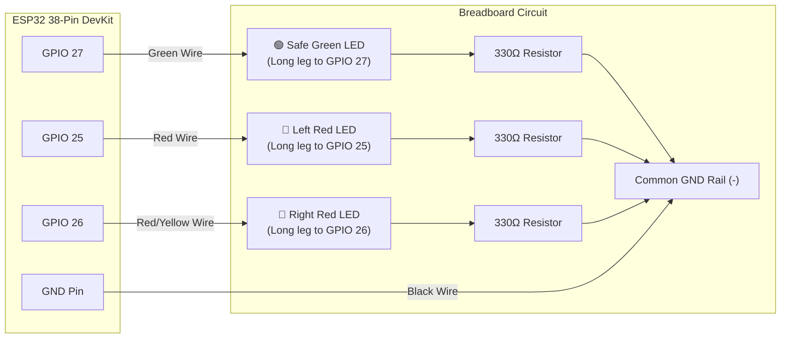

# BlindSpottr — Live Hardware Wiring & Physical Testing Guide

> **AUTHORITY:** This document provides the live step-by-step physical wiring instructions, electrical constraints, and bench test procedures for **BlindSpottr**.
>
> *Updated with each firmware milestone to match current firmware pin definitions and testing capabilities.*

---

## ⚡ CURRENT ACTIVE BENCH TEST: Component 1 — Cockpit LED Cluster

We are bringing up the hardware **one component at a time**. The currently active firmware on `dev` compiles and tests the **Cockpit LED Indicators (Safe Green + Left/Right Red Alert LEDs)**.

### 1. Required Parts for this Step
* 1× **Green LED** (Safe Status Indicator)
* 2× **Red LEDs** (Left Hazard & Right Hazard Warnings)
* 3× **220Ω or 330Ω Resistors** (Current limiting for LEDs)
* 4× Jumper wires (Male-to-Male)
* 1× Breadboard
* 1× ESP32 38-Pin DevKit V1 + Micro-USB cable

---

### 2. Simple Component 1 Wiring Diagram



---

### 3. Step-by-Step Connection Guide

1. **Locate the Ground (GND) Pin:**
   - Connect a black jumper wire from any `GND` pin on the ESP32 to the blue negative (`-`) rail of your breadboard.
2. **Wire the Green Safe LED (`GPIO 27`):**
   - Identify the LED legs: **Long leg = Anode (+)**, **Short leg / flat rim = Cathode (-)**.
   - Insert the Green LED into the breadboard.
   - Connect a jumper wire from **ESP32 GPIO 27** to the **Long leg (+)**.
   - Connect a **330Ω resistor** from the **Short leg (-)** to the **GND rail**.
3. **Wire the Left Red Alert LED (`GPIO 25`):**
   - Insert a Red LED into the breadboard.
   - Connect a jumper wire from **ESP32 GPIO 25** to the **Long leg (+)**.
   - Connect a **330Ω resistor** from the **Short leg (-)** to the **GND rail**.
4. **Wire the Right Red Alert LED (`GPIO 26`):**
   - Insert the second Red LED into the breadboard.
   - Connect a jumper wire from **ESP32 GPIO 26** to the **Long leg (+)**.
   - Connect a **330Ω resistor** from the **Short leg (-)** to the **GND rail**.

---

### 4. How to Flash and Test on Hardware

#### Step 1: Connect USB & Upload Firmware
Plug your ESP32 into your computer via micro-USB, then run:
```bash
/opt/homebrew/bin/pio run -t upload
```

#### Step 2: Open Serial Monitor
Open the PlatformIO serial monitor at 115200 baud:
```bash
/opt/homebrew/bin/pio device monitor -b 115200
```

#### Step 3: Observe Automatic Cycle
You will see the console log each state transition every 3 seconds, and the LEDs will react in real time:
1. **Seconds 0–3: `[STATE_SAFE]`**
   - **Green LED:** Solid ON
   - **Left Red LED:** OFF
   - **Right Red LED:** OFF
2. **Seconds 3–6: `[STATE_LEFT_WARNING]`**
   - **Green LED:** OFF
   - **Left Red LED:** Pulsing / Blinking (120 ms cadence)
   - **Right Red LED:** OFF
3. **Seconds 6–9: `[STATE_RIGHT_WARNING]`**
   - **Green LED:** OFF
   - **Left Red LED:** OFF
   - **Right Red LED:** Pulsing / Blinking (120 ms cadence)
4. **Seconds 9–12: `[STATE_BOTH_WARNING]`**
   - **Green LED:** OFF
   - **Left Red LED:** Solid ON
   - **Right Red LED:** Solid ON
   - *Cycle repeats automatically!*

#### Step 4: Interactive Manual Testing
In the Serial Monitor terminal, you can interact directly:
* Type **`0`** and press Enter → Locks into `STATE_SAFE` (Green LED stays ON).
* Type **`1`** and press Enter → Locks into `STATE_LEFT_WARNING` (Left Red pulses continuously).
* Type **`2`** and press Enter → Locks into `STATE_RIGHT_WARNING` (Right Red pulses continuously).
* Type **`3`** and press Enter → Locks into `STATE_BOTH_WARNING` (Both Red stay solid ON).
* Type **`a`** and press Enter → Resumes automatic 3-second cycling.

---

### 5. Troubleshooting Checklist

| Symptom | Cause | Solution |
| :--- | :--- | :--- |
| **LED doesn't light up** | Reversed polarity | Rotate the LED 180° so the long leg connects to the ESP32 GPIO. |
| **LED is extremely dim** | Resistor value too high | Ensure you are using 220Ω or 330Ω (Red-Red-Brown or Orange-Orange-Brown). Do not use 10kΩ. |
| **Wrong LED blinks** | Swapped GPIO pins | Verify GPIO 25 is Left Red, GPIO 26 is Right Red, and GPIO 27 is Green. |
| **ESP32 resets on boot** | Short circuit | Disconnect USB immediately. Check that resistors are not bridging +3.3V/5V directly to GND. |

---

## 6. Master Full-System Hardware Pinout Table (Reference)

| Subsystem | Signal Name | ESP32 GPIO | Direction | Notes & Electrical Safety |
| :--- | :--- | :--- | :--- | :--- |
| **Safe Green LED** | `PIN_LED_SAFE`| **GPIO 27** | Digital Output | Active-HIGH push-pull + 330Ω resistor |
| **Left Red LED** | `PIN_LED_L` | **GPIO 25** | Digital Output | Active-HIGH push-pull + 330Ω resistor |
| **Right Red LED**| `PIN_LED_R` | **GPIO 26** | Digital Output | Active-HIGH push-pull + 330Ω resistor |
| **Active Buzzer** | `PIN_BUZZER` | **GPIO 14** | Digital Output | Component 2 target |
| **Left IR Sensor** | `PIN_IR_L` | **GPIO 34** | Digital Input | Component 3 target (Input-only GPI) |
| **Right IR Sensor**| `PIN_IR_R` | **GPIO 35** | Digital Input | Component 3 target (Input-only GPI) |
| **Left Radar** | `PIN_RADAR_L` | **GPIO 32** | Digital Input | Component 4 target (RCWL-0516) |
| **Right Radar** | `PIN_RADAR_R` | **GPIO 33** | Digital Input | Component 4 target (RCWL-0516) |
| **OLED SDA** | `PIN_I2C_SDA` | **GPIO 21** | I2C Data | Component 5 target (0.96" SSD1306) |
| **OLED SCL** | `PIN_I2C_SCL` | **GPIO 22** | I2C Clock | Component 5 target (0.96" SSD1306) |
